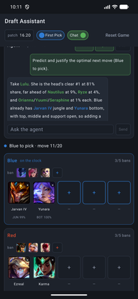
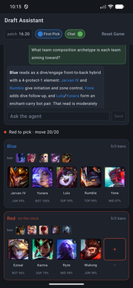
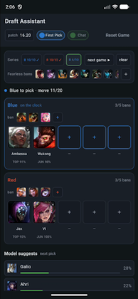
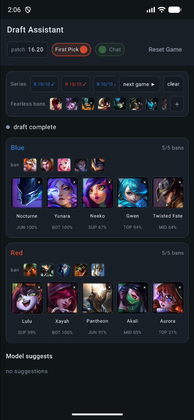
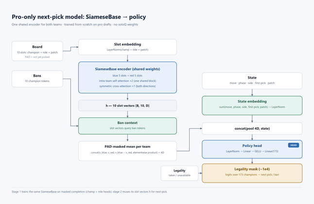
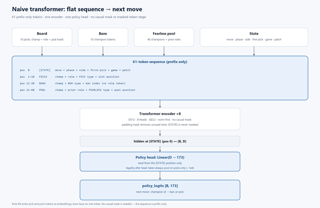

# LoL Draft Assistant (Android App)

Built a Kotlin Android App to suggest live draft moves based on pro league of legends games. An LLM agent is integrated to explain model decisions to users. Many models were built and trained with 47k pro drafts and 400k high-elo solo-queue games.

[See Portfolio Page for Demo](https://florianfrick.github.io/portfolio/loldraftassistant)

## Install the mobile release

1. Download the debug APK from the [v0.1.0 release](https://github.com/florianfrick/draft-analysis/releases/download/v0.1.0/app-debug.apk) (about 75 MB).
2. Transfer the `.apk` to your Android phone, or open the link on the phone itself.
3. Open the file in your Downloads app. If Android asks, allow **Install unknown apps** for the browser or file manager you used, then tap **Install**.
4. Open **Draft Assistant**. The offline suggestions need no account, backend, or network; the optional Chat toggle uses a Cloudflare Worker for explanations.

For a development install over USB:

```bash
adb install -r android/app/build/outputs/apk/debug/app-debug.apk
adb shell am start -n com.draftassistant/.MainActivity \
  --es demo blg_geng_worlds2026
```

## Local development

### Docker (Python training and evaluation)

The pinned Python environment lives in `Dockerfile` + `requirements.txt`. Data, checkpoints, and run outputs are bind-mounted from the host.

```bash
docker compose build dev                       # once
docker compose run --rm dev                    # interactive shell
docker compose run --rm -T dev python -m pytest pro/model/test_split -q
```

Copy `.env.example` to `.env` and fill in `RIOT_API_KEY` and/or `WANDB_API_KEY`, or pass `--no-wandb` to training. Raw and derived data are git-ignored. See [DOCKER.md](DOCKER.md) for the longer test matrix, training commands, and GPU checks.

### Android build

The Android SDK and JDK are kept outside the repo. Adjust the paths for your machine:

```bash
export JAVA_HOME=/e/android-toolchain/jdk/jdk-21.0.13+9
export ANDROID_HOME=/e/android-toolchain/sdk
/e/android-toolchain/gradle/gradle-8.9/bin/gradle --no-daemon -p android \
  :app:assembleDebug :app:testDebugUnitTest
```

See [android/README.md](android/README.md) for ExecuTorch asset regeneration, Worker setup, parity checks, and the on-device contract notes.

## Tools & languages

- Langraph, MCP, PyTorch, Python, SQL, Deepseek API, WandB
- Cloudflare, Kotlin, Jetpack Compose, ExecuTorch, Docker, Github


## Model training experiments

- **Naive transformer:** Full draft state as uniform input (61 tokens for [state], picks, bans, and fearless bans) achieving 20% top-1 and 54% top-5 on next-move prediction requiring nearly 1B parameters.
- **Siamese set transformer:** A permutation-invariant Set Transformer with shared intra-team self attention, inter-team cross attention, PMA pooling, and a linear prediction head. Trained via masked and causal modeling to achieve 19% top-1 accuracy with a 2.5M parameter model due to the architecture's inductive bias.
- **LLM finetuning:** Finetuned a small open weight model (Qwen3.5-4B) and a frozen siamese model trunk with a linear projector using QLoRA but hardly improved accuracy while dramatically slowing inference.
- **Agent model with MCP and LangGraph tool calling:** Created tools for sandbox draft state manipulation, base model predictors, and SQL querying. As a decision maker, could not surpass base model performance. Thus, the LangGraph version of a chat agent was not ported to the Android app.

## Test and Data Driven Training

- Started with an evaluation metric based on desired user experience (next-move prediction), and a relevant, fixed dataset train/val/test split (pro drafts split within patch).
- Created naive baselines (e.g. frequency lookup table or simple MLP) and continuously built complexity while always fairly comparing against the same metric and data.
- Experimented with many strategies including set transformers, local LLM finetuning, MCP and LangGraph.

## Android release

A Kotlin/Compose app with bundled assets and models. A Cloudflare worker holds the LLM secret key and applies rate limits to stop user abuse.
48,960
## Next-move results

Trained on 48,960 pro drafts with same test split. Results from `pro/model/test_split/REPORT_suite.md`:

| model | top-1 | top-5 | top-10 | mean rank | 95% CI | params |
|---|---|---|---|---|---|---|
| `00-frequency-table` | 10.8% | 34.4% | 50.8% | 17.83 | [10.5, 11.1] | 342,540 |
| `nextpick-forest-flat-v1` | 10.5% | 34.8% | 52.5% | 17.52 | [10.2, 10.7] | 2,753,344 |
| `nextpick-mlp-flat-v1` | 17.2% | 48.2% | 66.1% | 11.22 | [16.9, 17.5] | 2,996,705 |
| `nextpick-proonly-nov13-k5-through-lcp-df-sw` | 18.9% | 50.8% | 68.3% | 10.17 | [18.6, 19.3] | 3,350,879 |
| `nextpick-naivetransformer-d512-l8-h8-k5-through-lcp-df-sw` | 20.6% | 54.1% | 72.2% | 8.98 | [20.2, 21.0] | 25,509,037 |
| `nextpick-proonly-nov13-through-lcp-df-sw` | 17.4% | 48.3% | 66.3% | 10.90 | [17.1, 17.8] | 3,350,879 |

## Screenshots

| Predict | Explain | Mid-series | Completed |
|:---:|:---:|:---:|:---:|
|  |  |  |  |

## Model Architecture Diagrams

| Pro-only next-pick | Naive transformer |
|:---:|:---:|
|  |  |
