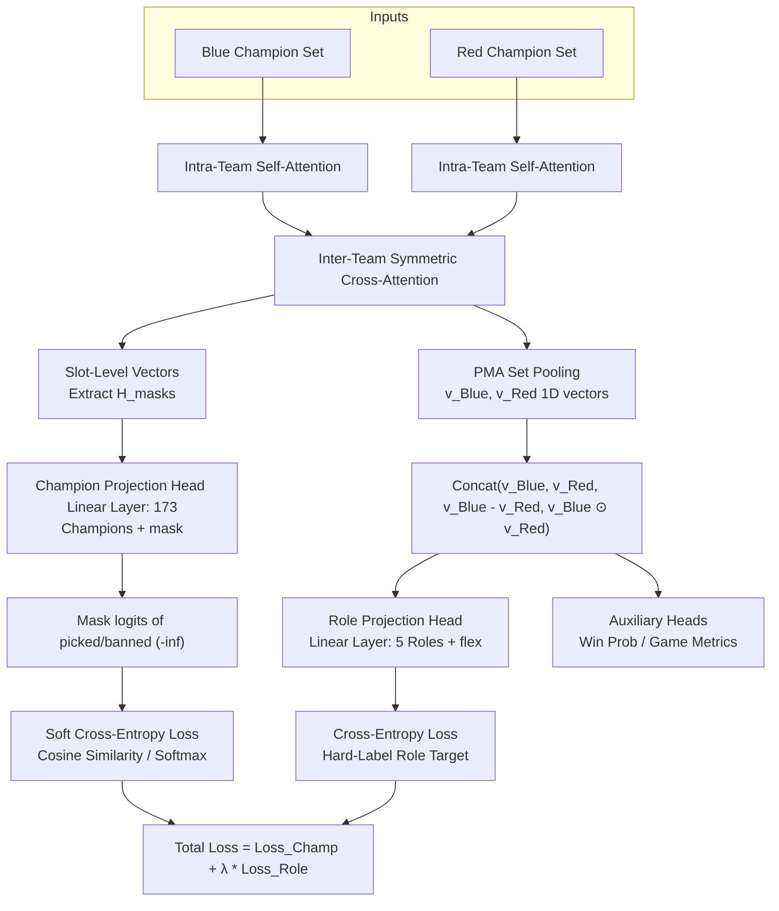

# LoL Draft Analysis

> **Current state of the project: see [STATUS.md](STATUS.md)** — one section per
> stage (pretraining, finetune, policy, prefix value), the exact checkpoints
> kept, the evaluation numbers for each, what failed and why, and the plan.

Project Goals:

Create a draft analyzer/helper/predictor for league of legends pro games. It should be able to predict which champion will be picked/banned next.

First, generate an understanding of champions, their role, strength on the patch, and synergies/counters. Use high elo soloQ games for lots of data (just one patch for now).

## Repo layout

Two tracks, one per data source. The split is the point: **the pro track is the
model that ships**, and it is where the work since 2026-11-03 has gone.

```text
data/        raw + derived data for both sources (git-ignored)
frontend/    local draft-assistant UI (127.0.0.1 only)
solo_queue/  everything trained on high-elo solo queue
pro/         everything trained on pro drafts
android/     native offline Android client (the shipped app)
  worker/    optional Cloudflare proxy for the Agent chat toggle
```

`main` is the single release line. The Python/browser stack and the `exp/*`
history remain here because they document how the shipped models were chosen;
they are not required to build or run the Android app. `STATUS.md` is the
measurement record, and `FINDINGS.md` indexes the retained experiment snapshots.

The base encoder is defined **once**, in
`solo_queue/model/pretraining/base_model.py`, and `pro/` imports it. That is a
*code* dependency only: `proonly` trains the same architecture from scratch on
pro drafts, and no pro checkpoint starts from a solo-queue weight. The name
"soloQ pretraining" belongs to the solo-queue *stage*; the architecture it
produces is the siamese base, and both tracks use it.

### `solo_queue/`

| path | what it is |
|---|---|
| `model/pretraining/` | the siamese base encoder (`base_model.py`) + masked champ/role pretraining (`--role-only-prob 0.10` teaches P(role\|champ)) |
| `model/finetune/` | pro-play Stage 1 finetune on the frozen base: masked heads + win/econ heads (`value.py` for the prefix value function) |
| `model/policy/` | Stage 2 next-move policy on the frozen base (bans → state → policy head) |
| `model/tests/` | the I/O contract tests for the base encoder |
| `model/checkpoints/` | `masking-soloqueue`, `masking-finetune`, `nextpick-policy` |
| `analysis/` | soloQ data analysis: duckdb store, meta-overlap report, query explorer |

### `pro/`

| path | what it is |
|---|---|
| `model/proonly/` | **the recipe that ships** — pro drafts only, from scratch, patch embedding, within-patch split. Masked stage, next-pick stage, paired comparison |
| `model/test_split/` | **the evaluation suite**: the one canonical split (39,720 / 4,771 / 2,448) and two task suites — `next_move` and `masked` — that score any checkpoint against the shipped pair |
| `model/baselines.py` | the flat-feature encoding the non-neural baselines share, and the legality rule that keeps their candidate set identical to the policy model's |
| `model/mlp/` | flat-feature MLP baseline (~0.8 M params, both tasks) |
| `model/forest/` | random-forest baseline, used as a candidate scorer (both tasks) |
| `model/checkpoints/` | the shipped pair — `masking-proonly-nov13-…` and `nextpick-proonly-nov13-k5-…` — plus the four `*-flat-v1` baseline artefacts |
| `model/agent/` | the LLM agent that holds the board as an object and calls the models through tools |
| `model/archive/` | everything retired: `proto/`, `bans/`, `winpred/`, `llm/`, the old pinned-split harness, and `archive/checkpoints/` with every checkpoint that is not the shipped pair |

Each track keeps its own artefact store, so "which data trained this" is a
path prefix, not a naming convention. Weights are git-ignored in both.

### Which model actually ships

Both frontend defaults are pro-track (`frontend/server.py`), and both moved to
the 2026-11-13 corpus on 2026-11-14:

- **role board / masked completion** — `masking-proonly-nov13-through-lcp-df-sw`
- **next move** — `nextpick-proonly-nov13-k5-through-lcp-df-sw` (pro-only policy, 5 prefixes per game per epoch)

That pair is a **different corpus** from everything in `STATUS.md` §7: the
corpus freeze is lifted (46,939 drafts through 2026-11-13), the pinned test
series are ordinary rows, the split is a fractional 85/10/5 within-patch tail,
and there is no fixed holdout. Its own numbers are top-5 **0.5083** (rel 3.36x)
on 2,448 test games, and +2.55 pp over the same recipe with one prefix
(p 2.7e-51). Do not put them in the §7 table below, which is the older corpus.

**Shipped Android app.** `android/` bundles that same pair as ExecuTorch
`policy.pte` / `masker.pte` assets and runs them entirely on the phone, with
bundled portraits and static metadata. It needs no backend, auth, or API key.
The Agent chat toggle is off by default; when enabled it calls the optional
Cloudflare Worker in `android/worker/`, which holds the DeepSeek key as a
secret. See `android/README.md` for build, parity checks, and Worker setup.

The measured case for the pro track (`STATUS.md` §7, pinned Worlds 2026 test split):

| task | solo-queue-trained | pro-trained |
|---|---|---|
| next move, top-5 | 0.479 (`nextpick-policy`) | **0.564** (`nextpick-proonly`) |
| masked completion, top-5 | 0.529 (`masking-soloqueue`, pretrain only) | 0.714 pro-only / **0.743** soloQ→pro finetune |

Training on pro drafts is what buys accuracy; solo-queue pretraining on its own
is the weakest encoder in its own family, and fine-tuning it on pro drafts only
ties the from-scratch pro model on 70 slots. That is why the pro recipe is the
one that gets maintained and the solo-queue track is kept as the reference
point for the question "does the pretraining help at all".

The next-move default changed again on 2026-11-07, from the 3-member
`nextpick-proto-ensemble` to the ban-aware arm: same corpus and split, three
flags on, **+0.60 pp top-5 over its own control** (0.5056 vs 0.4995, p 4.3e-8).
That is a *val* number on one seed — the ensemble's +1.33 pp was measured on the
439 draft rows neither it nor its predecessor had trained on, so the two are not
comparable and must not be added (`pro/model/archive/bans/README.md`, `STATUS.md` §7).
The ensemble is still selectable in the UI; its members are fixed at three and
evicting one on a single seed would void the number that describes it.

## Setup (keys + data stay local, never committed)

### Environment: Docker

The Python environment is pinned in `Dockerfile` + `requirements.txt` (python
3.13, torch 2.14.1+cu126, numpy/pandas/pyarrow/scipy/sklearn/duckdb/wandb).
Use it instead of a machine-level install — the local interpreter's
`site-packages` got wiped once and took the whole toolchain with it.

```bash
docker compose build dev        # once
docker compose run --rm dev     # shell in the project, data bind-mounted
```

See `DOCKER.md` for tests, training, long runs and GPU checks. Everything below
also works verbatim on the host if you already have the pinned versions.

1. Copy `.env.example` to `.env` and fill in:
   - `RIOT_API_KEY` — Riot dev key (https://developer.riotgames.com,
     expires every 24h). Used by `data/solo queue/collect_*.py` via
     `data/solo queue/riot_api.py`.
   - `WANDB_API_KEY` — W&B key (https://wandb.ai/authorize), or pass
     `--no-wandb` to training. `docker-compose.yml` loads `.env` into the
     container, so every trainer reads it from the environment; there is no
     key file on disk.
2. Rebuild data locally (all raw/derived match data is git-ignored):
   - SoloQ: `collect_puuids.py` → `collect_matchids.py` →
     `collect_match_data.py`, then the process-matchdata pipeline caches
     `drafts_<patch>.pt`.
   - Pro: drop Oracle's Elixir CSVs into `data/pro play/` and run
     `pipeline.py --rescan` to build `pro_drafts.pt`.
3. Train: `python solo_queue/model/pretraining/train.py --epochs 30`
   (smoke: `--limit-drafts 4000 --epochs 2 --no-wandb`).
   Checkpoints are git-ignored (100MB+ each) — both the kept artefacts under
   `<track>/model/checkpoints/` and any `ckpt/run_*/` a trainer writes.
   W&B run directories land in `<track>/model/<folder>/wandb_runs/`, next to the
   trainer that wrote them.
   Share weights out-of-band (releases, drive, etc.), never via git.

See each folder's README for full commands.

- Multiple embedding layers summed e.g. champion (num champions + \[MASK\] + \[PAD\]), role (num roles + unknown/flex), team and patch if necessary

    ```python
    class DraftSlotEmbedding(nn.Module):
        def __init__(self, num_champs=173, num_roles=6, embed_dim=128):
            super().__init__()
            # Static lookup tables
            self.champ_lookup = nn.Embedding(num_champs + 1, embed_dim) # +1 for [MASK]
            self.role_lookup  = nn.Embedding(num_roles, embed_dim)      # Top, Jg, Mid, Bot, Sup, [FLEX]
            self.layer_norm   = nn.LayerNorm(embed_dim)

        def forward(self, champ_ids, role_ids, team_ids):
            # Summing embeddings overlays role & team context onto the static champion ID
            x = (self.champ_lookup(champ_ids) + 
                self.role_lookup(role_ids))
            
            return self.layer_norm(x)
      ```

- Masked modeling champion prediction in full draft (~15% chance to mask a champion and its role)



- Auxiliary prediction heads (game duration/outcome, team/lane gold lead at x minutes, kills, deaths, objectives). More comprehensive + win probability estimate.
- Possibly weigh loss differently based on game outcome (e.g. a team that loses might have made a draft mistake)


Then, finetune / use with another model architecture for pro game draft order and fearless bans

- Next pick/ban decision model
- Desired frontend UI that, given the current state of a draft, can show all of the top viable options for all remaining roles.
    This should allow a coach, for example, to see not just what counterpicks are available in the next pick, but what the opponent's ideas are.
    When evaluating the current draft and the remaining roles, keep in mind that a flex pick might be placed in several roles.
- Not sure on the architecture or training yet.


Why set attention blocks (and not ISAB):

- https://arxiv.org/pdf/1810.00825
- The same champion can not be picked twice and only the current state of the draft matters for the next pick. The order in which previous picks/bans were made doesn't matter.
- Thus, permutation invariance and no positional embedding is desired.
- Do NOT need induced set attention because the number of champions in a draft is very small.
- They should be Siamese (same weights for blue and red team)


Draft Format:

Fearless bans (previously played champions in the series can not be picked again)
First pick no longer always blue.
Ban Phase 1: Blue / Red Alternating 3 bans per side (3-3 split)
Pick Phase 1:   B1
                R1, R2
                B2, B3
                R3
Ban Phase 2: Red / Blue Alternating 2 bans per side (2-2 split)
Pick Phase 2: R4
                B4, B5
                R5


Best model so far (see STATUS.md for the numbers; the shipped defaults are the
last two rows):

| track | checkpoint | what it is |
|---|---|---|
| solo_queue | `masking-soloqueue` | soloQ pretrain (kept as the init, not retrained) |
| solo_queue | `masking-finetune` | soloQ → pro finetune |
| solo_queue | `nextpick-policy` | soloQ encoder + policy head |
| pro | `masking-proonly` | pro drafts only, from scratch |
| pro | `nextpick-proonly` | pro drafts only, encoder + policy from scratch |
| pro | `masking-proonly-nov13-through-lcp-df-sw` | **shipped role board** (46,939-draft corpus) |
| pro | `nextpick-proonly-nov13-k5-through-lcp-df-sw` | **shipped next move** (k=5 prefixes) |
| pro | `masking-proonly-randomvalsplit-through-wlds-ig-tes` | previous role board — selectable |
| pro | `nextpick-bans-aware-through-wlds-ig-tes` | ban-aware policy — selectable, previous default |
| pro | `nextpick-proto-ensemble` | 3-member logit mean — selectable, the default before that |