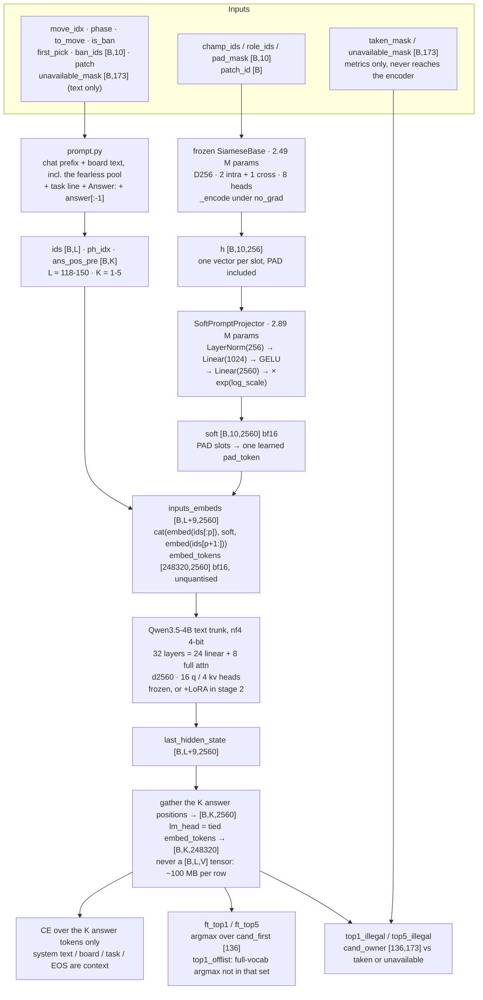

# Draft encoder -> soft prompt -> Qwen3.5

Branch `exp/finetune-llm`. Two stages, both here, both runnable:

| stage | script | encoder | projector | LLM |
|---|---|---|---|---|
| 1. warmup | `warmup_projector.py` | frozen | **trained** | frozen |
| 2. fine-tune | `finetune_lora.py` | frozen | **trained** | **QLoRA** |

```
python -m pro.model.llm.warmup_projector --max-train 3000 --epochs 2
python -m pro.model.llm.finetune_lora --init-projector <warmup>/projector.pt
python -m pro.model.llm.evaluate_llm --projector <ckpt>/projector.pt [--adapter <ckpt>/adapter]
```

Run them through `bash pro/model/llm/run.sh ...` (see *Environment*).

## What it is



What the code actually does, and the defaults that matter:

- **The encoder is `_encode`d, not `forward`ed.** `soft_tokens` calls
  `self.encoder._encode(enc_batch)` under `torch.no_grad()`, and
  `common.encoder_batch()` whitelists exactly `champ_ids / role_ids /
  pad_mask / patch_id` — so `taken_mask` *cannot* reach it. That whitelist is
  the structural reason the ten soft tokens cannot encode the fearless pool;
  it is not an omission in the projector.
- **The splice is one `torch.cat` because the placeholder sits at the top of
  the user turn.** `ph_idx` is therefore constant across the batch and there
  are no position ids to fix up. Everything at or after it shifts by
  `n_soft - 1 = 9`: `splice_positions` does that for the scored positions,
  `spliced_mask` does it for `attn` (the soft block is always attended).
- **The head is applied to `[B,K,2560]`, not `[B,L,2560]`.** V = 248,320, so a
  full-sequence logit tensor is ~100 MB per row and would be the largest
  allocation in the step. Only the 1-5 answer positions are ever read.
- **The head is the tied embedding.** `tie_word_embeddings: true`, so
  `get_output_embeddings()` returns the same matrix `embed_tokens` points at:
  there is no separate 636 M-parameter output layer, and in stage 1 that matrix
  is frozen like everything else.
- **The loss is exactly the answer tokens.** `assemble` builds
  `ans_ids`/`ans_pos_pre` and truncates the input to `prompt + answer[:-1]`;
  system text, board, task line and EOS never enter it. `--loss-on-eos`
  appends `<|im_end|>` to the scored set and is off by default.
- **The projector is 2,890,241 parameters:** `LayerNorm(256)` 512 +
  `256·1024 + 1024` + `1024·2560 + 2560` + `pad_token` 2560 + `log_scale` 1.
  `log_scale` is initialised so the projected RMS matches the embedding
  table's (0.0130 against a raw 0.199, i.e. scale 0.0656) and stays learnable.
- **`ft_top*` is 136-way, not 173-way.** 24 first-token collision groups cover
  61 of the 173 names and the largest stands for 6 champions, so
  `cand_owner [136,173]` is what turns a first-token argmax into "which
  champions does this stand for" — and `top1_illegal` asks whether *every*
  champion behind the chosen token is already taken or fearless-unavailable.
- **Stage 2 changes one node.** `attach_lora` adds r16 / α32 / dropout 0.05
  adapters on `q,k,v,o,gate,up,down_proj` over a
  `prepare_model_for_kbit_training` base; the encoder, the projector's inputs
  and the prompt are unchanged, so the difference between the stages is only
  what the LLM does with the same `inputs_embeds`.
- **4-bit is not optional.** bf16 weights are 8.4 GB and do not fit; nf4 +
  double quant with bf16 compute lands at 3.12 GB including the unquantised
  embedding table. Gradient checkpointing (`use_reentrant=False`) on the trunk
  is what keeps the backward under the card — see *Measured cost*.

The encoder is `masking-proonly-randomvalsplit-through-wlds-ig-tes`, the
shipped pro-only masked model. It is not modified: `_encode` is called under
`no_grad`, so the experiment cannot quietly retrain the thing it is measuring.

## Three decisions that differ from the brief, and why

**1. The board is rendered as text as well as soft tokens.** The sketch put
`[DRAFT_TOKENS]` in a prompt with no board. That asks a frozen 4B model to
recover entity identity - which champion is in which slot, which are banned -
from ten continuous vectors, and free generation has no `-inf` legality mask,
so nothing stops it naming a champion that is already gone. The text carries
the *facts*; the soft tokens carry the encoder's *judgement*, which is the part
text cannot express. `--context soft` restores the pure-channel variant, so the
question "does the channel work on its own" stays answerable.

**What the soft block actually contributes (measured, `_probe_soft.py`).** The
"judgement" half of that sentence is mostly not true, and it is worth knowing
before building on it. Six arms on 2,400 identical rows of the shared val, same
head, same shortlist, same first-token mask, paired McNemar against `normal`:

| arm | what it changes | ft_top1 | delta | discordant | p |
|---|---|---|---|---|---|
| normal | - | 31.04 % | - | - | - |
| perm | order of the ten | 31.29 % | +0.25 pp | 25/31 | 0.50 |
| mean | one vector, ten times | 31.08 % | +0.04 pp | 67/68 | 1.00 |
| shuffle | another board's tokens | 30.46 % | −0.58 pp | 54/40 | 0.18 |
| pad | the projector's PAD embedding | 27.54 % | **−3.50 pp** | 167/83 | <0.001 |
| zero | zeros (out of distribution) | 16.54 % | **−14.50 pp** | 465/117 | <0.001 |

So: the block is **necessary but not informative**. Removing it (`pad`) costs
3.5 pp, while replacing it with a *different board's* tokens costs 0.6 pp that
is not distinguishable from noise, and collapsing the ten vectors to their own
mean costs nothing at all. The block is read as a bag carrying a coarse
"a real draft is in progress here" signal; the champions, lanes, bans and move
index all reach the model through the **text**. `zero` is not evidence about
content - a row of zeros is out of distribution for the trunk - which is why
`pad` is the arm that answers the question.

Three consequences. The ten-vector prefix can be **one** vector for free, which
removes the slot-index alignment question entirely (needs the projector
retrained, one warmup stage). Prompt annotation of the tokens cannot help:
order is worth 0.25 pp. And anything that has to make the model *reason* about
the board - user language included - is working against a channel that
demonstrably under-uses the board's content, so it needs an explicit weight
rather than a logit shift.

**2. Fearless bans are structurally invisible to the soft prompt.** The encoder
never receives `unavailable_mask` - it is a policy-stage input, applied as a
logit mask (`solo_queue/model/policy/model.py:_apply_legality`). So the ten slot vectors
*cannot* encode the fearless pool; only the prompt text can, and it does:

```
Blue Bans: Viktor, Rumble, Ziggs
Red Bans: Skarner, Ahri, Kalista
Fearless Bans: Xin Zhao, Vladimir, ...
```

`render_state(include_fearless=True)` is the default, so the line is present on
**18.0 % of the 4,000 eval rows** (720; 360 picks and 360 bans - measured by
`_show_prompt.py`, not assumed), and it is omitted rather than written as "none"
when the pool is empty. The measurable form of the question is `top1_illegal`
in `evaluate_llm.py`: how often the model's first choice is a champion that is
already taken or fearless-unavailable. The policy head scores 0 by
construction; this measures what moving the decision into text costs.

One asymmetry worth knowing: `_cand_illegal` treats the pool as illegal on
**ban** moves too, which is the *serving* rule (`infer._policy_batch` passes
`taken | unavailable`), not the training rule (`_apply_legality` masks it on
picks only, because the corpus has 8 bans whose target is a fearless-picked
champion). So `top5_illegal` on ban rows is stricter than the loss the policy
was trained under, and the 8 rows whose own label violates it are dropped from
`ft_top*_legal` by the `ok` mask rather than being scored as errors.

**3. The target is a name, 1-5 tokens long, not one entity token.** Only 22 of
the 173 names are a single token (`" Vi"` is, `" Kai'Sa"` is four); the length
histogram is `{1: 22, 2: 98, 3: 39, 4: 13, 5: 1}`. There are 136 distinct first
tokens for 173 names, so "a clean 1:1 mapping to discrete entity tokens" is not
something the tokenizer offers, and a first-token readout is a **136-way**
problem with ties - `candidate_tables` builds the owner matrix so the report and
the legality filter can say which champions a candidate stands for. `ft_top*` is
never compared to the policy head's 173-way numbers.

Consequence for the loss: cross-entropy is over the answer tokens only (system
text, board, task line and EOS are context). `--loss-on-eos` adds the stop
token to the scored set; it is off by default because an untrained projector
will spend its gradient learning to stop instead of learning to name.

## Prompt format v2 (2026-11-08)

The board rendering was rewritten to say *whose turn it is* and *which lane the
pick must fill*, and to split the bans by side:

```
Patch: 15.01 | Turn: Red 2 (Pick 4 of 10)
Blue Picks: Rumble (Top), Vi (Jungle)
Red Picks: Ezreal (Bot)
Blue Bans: Kalista, Varus, Ashe
Red Bans: Yone, Viktor, Zyra
Fearless Bans: Corki, Nocturne, Skarner, Azir, Rakan, Aphelios, Ambessa, Renata Glasc, Aurora, K'Sante
Task: Recommend the optimal Red Side pick for Top lane. Answer with champion name only.
Answer:
```

Four things worth stating, because each one is a decision rather than a style:

**The lane is new information, and it is a train/serve asymmetry.** The task
line now names the lane of the pick being asked for (`target_role`, always 0-4
on picks and perfectly balanced at 20 % each - checked, not assumed). In the
corpus that is the lane the champion *actually played*, which is only known
after the draft; at serving time it is the lane the user wants filled. So the
model learns `P(champion | board, lane to fill)`, and any later inference must
pass the lane in. That is deliberate (role-conditioned recommendation is the
useful product), but it does mean a v2 checkpoint cannot be scored or served by
code that does not supply a lane.

**A ban has no lane.** `Task: Recommend the optimal Blue Side ban.` - asking
for a lane on a ban would teach the model that the phrase carries no
information, and the ban half of the board is half the training signal.

**The ban sides are derived, not stored.** `BAN_SIDE_BY_SLOT ^ first_pick`
(`data/pro play/datasets.py`), the same rule the ban-aware policy model uses.
Deriving it keeps `swap_sides` correct for free: it flips `first_pick`, so the
two ban lists and the turn label flip with it. The split is covered by a test
that rebuilds both lists from `ban_ids` and the slot table.

**`v1` still renders.** Every number recorded before this date was measured on
the old text, and a projector is trained on the text as much as on the soft
tokens, so `--prompt-format v1` reproduces it exactly. `evaluate_llm.py` prints
a warning when the checkpoint's saved `prompt_format` disagrees with the one it
was asked to score with. Cost of the change: **+2.0 body tokens per row**
(99.7 → 101.7, measured over the 4,000-row val sample), which is 2 % of the
sequence and not a reason to prefer either format.

## Why this is not a policy head

The existing `nextpick-*` head is a 173-way classifier that scores
**0.183 top-1 / 0.499 top-5** on 95,160 val states. A 4B model asked to
*generate* a 1-5 token name from a soft prompt is solving a strictly harder
problem with a much weaker output interface, so it will not beat that, and the
report says so rather than pretending otherwise. What the LLM adds is the thing
the classifier cannot do: a reason. Stage 2 is therefore a step towards the CoT
dataset, not a replacement for the policy.

## Environment

`lol-draft:dev` has no C compiler, and Qwen3.5's hybrid linear-attention layers
fall back to a reference PyTorch implementation without `flash-linear-attention`
- which is Triton, which JIT-compiles. `pro/model/llm/Dockerfile` adds `gcc` and
`libc6-dev` and points `PATH` at the venv; `run.sh` supplies the mounts so the
HF and Triton caches survive between runs.

`run.sh` mounts the **repo root**, not this folder: `common.py` puts the repo
root on `sys.path` to import `solo_queue.model.pretraining`, and every module is
addressed as `pro.model.llm.*`. The image's `ENV PATH` names
`/workspace/pro/model/llm/.venv/bin`, so both `run.sh` and the image have to
agree with the folder's location - after the move on 2026-11-07 the script was
still `cd`-ing to `pro/` and every command died with `No module named 'pro'`.
Rebuild with
`docker build -f pro/model/llm/Dockerfile -t lol-draft:llm .` if the venv path
ever changes again.

The Python packages live in `pro/model/llm/.venv` (inside the bind mount, so they
outlive `--rm` and do not invalidate the 11.7 GB base image):
`transformers 5.22.2`, `peft 0.21.2`, `accelerate 1.15.0`,
`bitsandbytes 0.50.2`, `flash-linear-attention 0.6.0`.

> **The venv moved with the folder on 2026-11-07** (`model/llm/.venv` →
> `pro/model/llm/.venv`). Its `bin/python` resolves through the symlink and
> still finds the right prefix, but the `pip`/`accelerate` console scripts have
> the old absolute path in their shebang. Use `python -m pip` inside it, or
> rebuild it (`python -m venv .venv && .venv/bin/python -m pip install ...`).

## Measured cost on an 8 GB RTX 4060

These are the numbers that decided the defaults, not guesses. Measured with
`bench_step.py`, which prints the allocator state every step.

| configuration | step time | peak reserved |
|---|---|---|
| bf16 weights, no training | - | 8.4 GB (does not fit) |
| 4-bit, batch 2, grad-accum 8, seq ~140 | 3.1-5.1 s | 6.99 GB |
| 4-bit, batch 4, seq ~140 | dies after ~8 steps | 7.75 GB and climbing |

`PYTORCH_CUDA_ALLOC_CONF=expandable_segments:True` is not a micro-optimisation
here, it is the difference between a usable run and a 5.6 s/step crawl. Without
it the default size-bucketed allocator fragments against this workload's
variable sequence lengths, reserves 7.46 -> 9.09 GB over 12 steps, and on WDDM
every step after that spills to host RAM. With it, reserved is flat.

**Batch 4 does not fit**, even though 6.90 GB of reserved looks like it should:
it survives a short probe and then dies, and the failure is disguised as
`RuntimeError: CUDA driver error: device not ready` inside whatever allocation
comes next (`new_empty`, `torch.empty`, `silu`) - never as an OOM. Batch 2 with
`--grad-accum 8` is the operating point: same effective batch, ~4.4
examples/s, so the full 42,121-game split is ~2.5 h/epoch.

## Measured results

Stage 1, projector only (encoder and LLM frozen), 6,000 games, 2 epochs,
batch 2 x grad-accum 8, lr 3e-3 cosine. Val = 200 games = 4,000 states.

| | epoch 0 | epoch 1 | chance | encoder policy head |
|---|---|---|---|---|
| val ce | 2.5065 | 2.3623 | - | - |
| exact (whole name) | 3.33 % | 4.28 % | ~0 | 18.32 % top-1 |
| ft_top1 (136-way) | 4.25 % | 6.00 % | 0.74 % | - |
| ft_top5 | 15.88 % | 20.15 % | 3.68 % | - |
| mean first-token rank | 39.0 | 34.6 | 68 | - |
| top1_illegal | 0.55 % | 0.43 % | - | 0 % (masked) |
| top5_illegal | 4.10 % | 4.30 % | - | 0 % (masked) |
| **top1_offlist** | - | **0.30 %** | - | 0 % (vocab is 173) |

**The same protocol on `v2`** (identical rows, seed, lr and schedule; only the
prompt changed - see the v2 section above). Run 2026-11-08, checkpoint
`llm-warmup-v2`:

| | v1, epoch 1 | v2, epoch 1 | delta |
|---|---|---|---|
| val ce | 2.3623 | **2.0709** | -0.291 |
| exact (whole name) | 4.28 % | **8.67 %** | +4.40 pp |
| ft_top1 (136-way) | 6.00 % | **9.80 %** | +3.80 pp |
| ft_top5 | 20.15 % | **31.62 %** | +11.47 pp |
| mean first-token rank | 34.6 | **24.3** | -10.3 |
| top1_offlist | 0.30 % | **0.00 %** | -0.30 pp |
| top1_illegal | 0.43 % | 1.90 % | **+1.47 pp** |
| top5_illegal | 4.30 % | 16.28 % | **+11.98 pp** |

Picks carry the gain: `exact` 6.15 % -> 13.50 %, `ft_top1` 8.00 % -> 14.05 %.
Bans barely move (2.40 % -> 3.90 %), which is what a lane hint should do - bans
have no lane. By lane (picks only): Support 20.3 %, Jungle 13.8 %, Bot 12.5 %,
Mid 11.5 %, Top 9.5 % exact.

**Full corpus** (`--corpus 2022 --max-train 0`, 42,129 train games, 1 epoch,
2,633 steps, 3.6 s/step = 2.9 h), checkpoint `llm-warmup-full`:

| | 6,000 games x 2 ep | full corpus x 1 ep |
|---|---|---|
| val ce | 2.0709 | **1.8566** |
| exact (whole name) | 8.67 % | **12.45 %** |
| ft_top1 (136-way) | 9.78 % | **13.15 %** |
| ft_top5 | 31.62 % | **38.65 %** |
| mean first-token rank | 24.4 | **18.7** |
| top1_illegal | 1.80 % | 2.03 % |
| top5_illegal | 16.28 % | 16.85 % |

Picks reach **20.15 % exact / 20.65 % ft_top1** - level with the encoder policy
head's 18.32 % 173-way top-1, which is the comparison that matters, because the
soft-prompt channel had been ~3x worse. Bans 4.75 %. Every lane improves, and
the spread narrows: Top 9.5 -> 20.0 %, Jungle 13.8 -> 18.0, Mid 11.5 -> 16.5,
Bot 12.5 -> 19.0, Support 20.3 -> 27.3 %. Both pick phases gain (picks1 13.2 ->
21.7, picks2 14.0 -> 17.9) while `bans1` stays flat at 3.5 % - the first ban
phase has nothing on the board to read.

The illegal rate is flat, i.e. the fix is still the decode-time mask, and it
does not get worse with more data. `top1_offlist` is 0.00 % throughout.

Two protocol notes: 7x more unique games in one epoch beats two epochs over
6,000 (no repeated data), and the 3.6 s/step here vs 6.4 s/step on the earlier
run is contention, not a code change - other containers were sharing the GPU
during that run.

**Re-run on the raised freeze** (`llm-warmup-full2`, 2026-11-09: corpus frozen
at `2026-11-08`, 46,915 drafts -> train 42,162 / val 4,746 / test 7, 107 corpus
patches, 5 drafts on 16.22 mapped to `UNK`; 2,635 steps, 5.8 s/step = 3.8 h):

| | full (11-04 freeze) | full2 (11-08 freeze) |
|---|---|---|
| val ce | 1.8566 | 1.9097 |
| exact | 12.45 % | 11.75 % |
| ft_top1 | 13.15 % | 13.13 % |
| ft_top5 | 38.65 % | 37.05 % |
| mean first-token rank | 18.7 | 21.6 |
| top5_illegal | 16.85 % | 15.78 % |

**The two full/full2 columns are not comparable, and the difference is the val
set, not the data.** `eval_dataset` draws its 200 games with
`randperm(len(val))[:200]` under a fixed seed, so the permutation depends on
the *length* of the list: adding 3 games re-draws all 200. The two runs
therefore score on almost disjoint game sets, and the +0.053 ce / +2.9 rank is
the draw (the new tail includes the newest patches, which train barely covers),
not a regression. Only within-run deltas and same-corpus comparisons are safe
here - which is why `ft_top1` (13.15 vs 13.13) is the one number that carries
over, and why a `--resume` run is the only way to compare epochs of one model.
A stable val sample (fixed slice of the date-sorted list instead of a random
draw) would remove this trap; it is not implemented, so quote the corpus size
next to any ce from this stage.

**Stage 2 on top of it** (`llm-lora-full2`, QLoRA r16/alpha32 on the LLM +
projector lr 3e-4, llm lr 5e-5, 1 epoch = 2,635 steps, 6.2 s/step = 4.6 h).
Same 200-game / 4,000-state val for every row, so these deltas are real:

| | warmup (step 0) | 600 | 1,200 | 1,800 | 2,400 | 2,635 |
|---|---|---|---|---|---|---|
| val ce | 1.9097 | 1.7354 | 1.6316 | 1.5688 | 1.5209 | **1.5195** |
| exact | 11.75 % | 12.35 % | 14.70 % | 17.37 % | 18.10 % | **18.30 %** |
| ft_top1 | 13.13 % | 13.50 % | 15.02 % | 18.32 % | 18.95 % | **19.13 %** |
| ft_top5 | 37.05 % | 41.30 % | 45.60 % | 49.70 % | 52.15 % | **51.98 %** |
| mean rank | 21.6 | 16.7 | 14.4 | 12.7 | 11.7 | **11.6** |
| top1_illegal | 2.35 % | 0.90 % | 0.80 % | 0.27 % | 0.20 % | **0.20 %** |
| top5_illegal | 15.78 % | 9.98 % | 8.48 % | 5.35 % | 5.20 % | **5.15 %** |

Three things to take from it. **The channel now clears the encoder's own policy
head** - 19.13 % `ft_top1` vs the head's 18.32 % top-1, 51.98 % vs 49.95 %
top-5 - which is the opposite of the "3x worse" position the projector alone
was in. Treat it as indicative, not settled: the head's numbers are over the
95,160-row held-out test set and these are over 200 val games, and `ft_top1`
renormalises over 136 name prefixes while the head scores 173 champions, so
the LLM column is mildly flattered. Scoring the head on these exact 4,000
states is the check that would settle it and is not done.

**One epoch is enough.** Val ce 1.5209 -> 1.5195 over the last 235 steps, and
the mean train ce of the last 200 steps (1.519) equals the val ce (1.5195):
the model has saturated this data at this capacity, so a second epoch would buy
noise. This is also why `--resume --epochs 2` exists - it is the cheap way to
test that claim rather than a plan.

**LoRA fixes the legality problem the projector could not.** `top5_illegal`
15.78 % -> 5.15 % and `top1_illegal` 2.35 % -> 0.20 % without any mask, so the
adapters do learn what is off the board; the decode-time mask stays worth
having (it removes the last 5 % of top-5 candidates for free) but it is not the
lever it looked like at warmup.

**The legality regression is not a prompt-wording bug.** `top5_illegal` more
than triples, so the sharper distribution is naming champions that are already
gone - free generation has no `-inf` mask, unlike the policy head. Two checks
settled it:

* Slicing by `unavailable_mask.any()` (`evaluate_llm.py --by pool`): picks with
  a fearless pool are illegal at #1 **7.2 %** of the time vs **2.6 %** without,
  and bans are flat (0.3 % vs 0.2 %). The pool is where the illegality lives.
* `--prompt-format v3` restores v1's explanatory gloss (`Fearless Bans (picked
  earlier this series, cannot pick again):`) and re-scores the *same* v2
  weights: exact 8.70 % -> 8.67 %, `top1_illegal` 1.90 % -> 1.90 %, picks
  3.4 % -> 3.6 %. **No effect**, so the short label was not the problem and `v2`
  stays the default. `v3` is kept only so that test is reproducible
  (`eval_v3gloss.json`).

The fix for illegality is therefore at decode time, not in the prompt: mask
`cand_first` with `taken | unavailable` before argmax, exactly as
`_apply_legality` does for the policy head. That is a serving change and does
not alter any training number above.

`top1_offlist` is the fraction of rows where the **full-vocabulary** argmax at
the answer position is not one of the 136 name prefixes - i.e. where a free
decoder would start a word that no champion begins with. It is 12 of 4,000
rows, and 10 of those 12 are at move 6 (the last `bans1` ban), which is the
move where the board is most nearly empty and the prompt is least specific.
Measured after the fact with `evaluate_llm.py` (which reports it per phase and
per move), not during the run: `report.json` predates the metric, so the number
lives in `eval_offlist.json`.

Two things follow. **The off-list risk is real but tiny at this checkpoint** -
0.3 %, against 94 % of rows simply naming the wrong champion, so an invalid
token is not what is costing accuracy. And **`ft_top*` is mildly optimistic**
because it renormalises over the 136 candidates; the gap between it and what a
naive decoder would emit is exactly this 0.3 %. It matters much more at the CoT
stage, where the model emits free text before the name and a malformed answer
becomes likely; the fix there is a one-line logit mask over `cand_first` at
step 0, which is the same renormalisation `ft_top*` already applies.

**The channel carries real signal (5.8-8x chance on top-1) but is ~3x worse
than the encoder's own policy head reading the same state.** On this budget, 10
soft tokens through a 2.89M-param MLP are not enough for a frozen 4B to name
the next champion. The curve is still improving at epoch 1, so this is not a
ceiling - but "more of the same" is not obviously the answer either.

### The result this replaced, and why it was wrong

The first run scored **69.25 % exact / 98.6 % ft_top1**, 3.8x the policy head.
It was a copy task. `assemble` returned `ids = prompt + answer + eos`, and
`inputs_embeds` embeds everything after the placeholder, so the answer was in
the model's input - and the scored position was `len(prompt) + j`, i.e. *at* the
answer token, one too late. A causal model can read the token it is scored on.

Found by corrupting the target and watching the prediction follow the
corruption (`audit_label.py`): change `Ivern` to `Dr. Mundo` and the model says
` Dr`. The per-move breakdown was the first hint - moves 0-6 at ~10 % exact,
moves 7-19 at 99.5-100 % - and at move 0 the board is empty, so nothing could
have been predicted. Fix: score at `len(prompt) + j - 1` and truncate the input
to `prompt + answer[:-1]`. `test_scored_positions_predict_rather_than_read_the_answer`
guards it; the old test only checked the rendered *text*, not the tensor that is
actually embedded.

## Reranking the head's candidates

Both tracks ended up scoring about equally well - 19.13 % `ft_top1` for the LLM,
19.14 % top-1 for the head on the one set held out from both - so the remaining
gain is not in either model but in *combining* them: let the head produce a
shortlist and let the LLM choose from it. That is `--rerank K`, and its ceiling
is the head's recall@k, not a model number. (The 19.13-vs-18.32 reading of these
two numbers, which this file carried before 2026-11-09, compared a
partly-memorised set with a held-out one - see the split problem below. The
honest statement is that the two channels are level.)

**The ceiling, on the shared val** (4,763 games, 95,260 states - `rerank.py
--split heldout`, `eval_heldout_ceiling.json`):

| | top-1 | top-3 | top-5 | top-10 | top-20 |
|---|---|---|---|---|---|
| all | 18.44 % | 38.07 % | **50.51 %** | 68.36 % | 84.34 % |
| picks (n=47,630) | 22.59 % | 45.02 % | 58.27 % | 75.51 % | 88.85 % |
| bans (n=47,630) | 14.29 % | 31.11 % | 42.75 % | 61.21 % | 79.82 % |

The old table (51.85 % / 59.29 / 44.41 on the 478-game `common`) is retired:
that set was 92.3 % inside the shipped head's *train*, so both its ceiling and
the 35.31 % measured against it were mildly optimistic. The correction is
small - +1.3 pp of ceiling - because the head barely memorised its own train
(its own val top-5 is 49.95 % on 95,160 states), but the honest number is the
one above.

A perfect reranker at k=5 scores 50.51 %, against the 18.44 % the channel
reaches alone. The other half of the corpus is untouchable at that k, which is
the whole argument for choosing k against this table rather than by taste.

### The zero-shot result, before any reranker training

`llm-lora-full2` (trained on v2, never saw a candidate list) scored on the same
9,560 states with `--rerank 5`:

| | free generation | restricted to the head's top-5 |
|---|---|---|
| exact | 18.30 % | **30.00 %** |
| ft_top1 / k-way | 19.13 % | **32.17 %** |
| head top-1 | 19.14 % | - |
| ceiling (head recall@5) | - | 51.85 % |

So **62 % of the ceiling for free**: giving the model a shortlist and a mask is
worth +13 pp over free generation, and it beats the head's own top-1 by the
same margin, with no training at all. That also settles the answer format -
`exact` trails k-way accuracy by 2.2 pp, which is the cost of spelling a name
instead of emitting an index, so names stay.

The remaining 20 pp to the ceiling is what the reranker is trained for.

### The split problem, which was a seed, not a protocol

`split_within_patch` is shared and the two tracks *meant* to call it the same
way, but `common.SPLIT` passed `seed=0` while the head used the function's
default `pipeline.VAL_SPLIT_SEED`. Two independent 10 % draws of the same
corpus overlap on ~1 % of it, so **90 % of the LLM's val games sat inside the
head's training set** - measured (`_split_overlap.py`) and recorded here for
months as a difference in `val_random`.

It was not. The shipped head trained with `--val-split random --no-test`
(`pro/model/bans/probe.py` defaults; the checkpoint records `test: skipped
(--no-test)` and `init_ckpt = masking-proonly-randomvalsplit-*`), which is the
same `val_frac=0.10, val_random=True` the LLM uses. Dropping `seed=0` from
`SPLIT` makes the two partitions identical: **0.3 %** of the LLM's val is in
the head's train (14 of 4,763 games), and that residue is only the 7 pinned
test games the head's `--no-test` run did not remove. A retrain that keeps the
pinned tail on both sides makes train/val/test bit-for-bit identical, which
`test_rerank.py` now asserts.

So there is one split and one comparison set:

| split | games | what it is | valid for |
|---|---|---|---|
| `heldout` | 4,763 | the shared val, no training rows | **any** cross-model number; the recall@k ceiling |
| `rr` | 2,381 / 2,382 | the shared val cut in half by game | training *and* evaluating the reranker |

`heldout` is 95,260 states - SE ~0.15 pp at a 35 % top-1. One caveat: the
head's `best.pt` was *selected* on this val, so it is mildly optimistic as a
held-out set for the head. Noted, not corrected - fixing it means retraining
the head with a separate selection split.

`rr` exists because the old pool was contaminated. It trained on `headheld`
minus `common`, and **90.5 % of `headheld` was in the real head's train**, so
the reranker learned from candidate lists the head had memorised and then
scored itself on clean ones. Training and evaluating on halves of the shared
val puts both sides at serving difficulty. The 35.31 % below was measured on
the old 478-game `common`, which *is* clean, so the number stands - it is just
underpowered, and the pool that produced it was the wrong one.

### The prompt (v4)

v2's board, one appended line, and a task line that asks for a choice:

```
Patch: 16.21 | Turn: Red 2 (Pick 4 of 10)
Blue Picks: Rumble (Top), Vi (Jungle)
Red Picks: Azir (Mid)
Blue Bans: Yone, Smolder
Red Bans: Kalista
Fearless Bans: Aurora, Skarner
Candidates: Jax 31%, Renekton 22%, Gnar 14%, K'Sante 11%, Ornn 9%
Task: Choose the best Red Side pick for Top lane from the candidates. Answer with champion name only.
Answer: Jax
```

The list is the head's top-k over **legal** champions (`policy_logits` is
already -1e4-masked), so the reranker cannot re-introduce the `top5_illegal`
problem - its answer is legal by construction. The percentages are the head's
raw softmax over the legal set, not renormalised over k, so the model can tell
a confident head from a flat one. `test_v4_is_v2_plus_one_candidate_line` pins
that the board lines are byte-identical to v2, which is what makes a v2
projector the correct initialisation.

### The loss and the metric

`keep` [B,V] masks the **first** answer position to the candidates' first
tokens *before* the log-softmax, so the objective is a k-way cross-entropy over
the list rather than a full-vocabulary one with a smaller argmax set. Two
consequences worth knowing before reading a number:

* `ft_top5` saturates at 1.000 whenever k <= 5. That is the mask working, not a
  metric.
* `ft_top1` is *group* accuracy: 24 first-token groups cover 61 of the 173
  champions, so the model can pick the right group and still spell a different
  champion that shares its first token. `exact` is the number to quote for "did
  it name the right champion", and the gap between the two is the cost of
  answering with a name instead of an index.

### The training set

4,303 games x 20 moves = 86,060 rows, of which **51.85 % carry a learnable
answer at k=5** -> ~44,600 usable pairs (`rerank.py --build-pairs`). A row whose
answer is not in the list is dropped rather than trained on with a zero loss:
there is nothing to learn from it, and including it teaches the model that the
shortlist is usually wrong when it is usually right. `--moves-per-game 1` keeps
the one-prefix-per-game-per-epoch recipe, drawing the move from that game's
*usable* moves, so an epoch never spends a step on a dead row.

### The trained reranker

`llm-lora-rerank5`: 2 epochs, 536 steps, 2 h 3 m, initialised from
`llm-lora-full2` (adapter + projector), `--moves-per-game 1`, prompt v4.

| | step 0 (zero-shot) | step 268 (ep 0) | step 536 (ep 1) |
|---|---|---|---|
| k-way accuracy | 32.17 % | 30.81 % | **35.31 %** |
| exact | 30.00 % | 30.16 % | **34.65 %** |
| val ce | - | 0.8948 | 0.7944 |
| train ce | - | 0.621 | 0.543 |

**The first epoch is below the starting point, and that is not a bug.** The
model has to stop reading the board as a generation prompt and start reading it
as a selection prompt; 268 steps at 5e-5 is spent on that shift, and only the
second epoch beats the untrained model. So 35.31 % is a *minimum*, not a
converged number - the train ce is still falling and one more epoch is
unmeasured rather than shown to be flat. Do not quote it as "the reranker
scores X" without that caveat.

Against the three baselines that matter, on the same 9,560 states:

| | k-way |
|---|---|
| head top-1 (no LLM) | 19.14 % |
| LLM free generation | 19.13 % |
| LLM + shortlist, untrained | 32.17 % |
| LLM + shortlist, trained | **35.31 %** |
| ceiling (head recall@5) | 51.85 % |

So the pipeline nearly doubles the head's top-1, but **80 % of that came from
the format and 20 % from the training**: +13.0 pp from handing over a shortlist,
+3.1 pp from fitting it. The training is worth having and is not the main
effect - worth saying plainly, because the "+16 pp over the head" headline is
mostly a statement about the shortlist, not about reasoning.

**Where the headroom actually is** - conversion rate = k-way / head recall@5:

| | head recall@5 | zero-shot | trained | conditional |
|---|---|---|---|---|
| picks (n=4,780) | 59.29 % | 45.17 % | **47.09 %** | 79.4 % |
| bans (n=4,780) | 44.41 % | 19.16 % | **23.56 %** | 53.0 % |

Bans gained 2.3x what picks gained (+4.39 vs +1.92 pp), which is the reverse of
where the eye goes: picks are already at 79 % conversion, so at k=5 there is
almost nothing left to win there. Bans are the weak half on *both* sides - the
head recalls less (44.41 %) and the model converts less (53.0 %) - and they are
half of every draft. Any further k=5 work should be aimed at bans; for picks,
the ceiling is the constraint, not the model.

Per role (picks only), exact accuracy: Support +9.7 pp (41.84 -> 51.57, now the
best role), Top +6.1, Bot +3.0, Mid +2.0, Jungle +1.6. Support is the most
compositional pick on the board, which is consistent with the text channel
helping most where the choice depends on the rest of the team.

One counter-intuitive line in `by_phase`: `picks2` exact rose 3.1 pp while its
k-way stayed flat (-0.2 pp). k-way is first-token *group* accuracy, so that
combination means it fixed confusions *inside* a first-token group - it was
naming the right champion more often without changing which group it aimed at.
This is the `ft_top1` vs `exact` distinction doing real work, not noise.

**Cost, which is the actual shipping decision.** The head is 2.49 M params; the
reranker puts a 4.2 B model in the loop for every pick. That is milliseconds
versus seconds per recommendation, for +16 pp top-1. Nothing about the accuracy
argument decides this - it is a latency question, and it is the reason the
reranker should be an optional path rather than a replacement for the head.

## Files

| file | what |
|---|---|
| `common.py` | corpus, split, names, board rendering, frozen encoder |
| `prompt.py` | chat template, soft-token splice, scored positions |
| `draft_llm.py` | projector + assembled model + metrics |
| `build.py` | 4-bit loader, LoRA attach, save/load |
| `data.py` | datasets (thin wrapper over `data/pro play/datasets.py`) |
| `metrics.py` | count-based accumulators |
| `train_util.py` | eval loop, LR schedule, param groups |
| `evaluate_llm.py` | sliced scoring: ban vs pick, per phase, legality |
| `bench_step.py` | allocator/throughput probe; prints reserved per step |
| `_name_stats.py` | tokenizer-only: the 173 names' token-length histogram and first-token collisions |
| `_show_prompt.py` | prints a real prompt with a fearless pool, and how many rows have one |
| `_show_example.py` | one train row end to end: tensors, prompt, ids, soft tokens, top-k, greedy generation |
| `_probe_soft.py` | what the soft block contributes: perm / mean / shuffle / pad / zero, paired McNemar |
| `audit_leak.py` | split overlap + target-in-board check on the real corpus |
| `audit_label.py` | corrupt the target; does the prediction follow? |
| `audit_positions.py` | which position actually predicts, and text vs soft split |
| `audit_tensors.py` | is the answer in any tensor the encoder reads |
| `audit_encoder.py` | raw tensors at the move-6/7 boundary |
| `audit_targets.py` | target distribution per move (is the val sample degenerate) |
| `audit_eyeball.py` | one game's 20 predictions next to their targets |
| `rerank.py` | head loader, `split_games`, `candidates`, `keep_mask`, `build_pairs`, recall@k |
| `_split_overlap.py` | whether the two tracks hold the same games out (they do: 0.3 %, and that is the pinned test tail) |
| `test_llm_prompt.py` | contract tests for the splice and the prompt formats (14, CPU only) |
| `test_rerank.py` | contract tests for the candidate list, the split and the pair builder (10) |

## Next step

**k=10, aimed at bans.** At k=5 the picks path is finished - 79 % conversion on a
58.27 % ceiling - while bans sit at 53 % on a 42.75 % ceiling, so at this k the
head is the ban bottleneck and the LLM cannot fix it. The arithmetic for k=10 is
the reason to spend the run: picks 75.51 % x 0.79 = 60 % (+14 pp), bans
61.21 % x 0.53 = 32 % (+10 pp), together ~46 % against the 68.36 % k=10 ceiling.
That holds only if conditional accuracy survives the extra five candidates,
which is unmeasured - it needs above ~62 % to beat what is there now. Cheaper
intermediate: one more epoch at k=5 (`--resume`), which is 1 h and tells us
whether 35.31 % is the plateau or the first point on a slope.

After that, a bootstrapped CoT SFT dataset: sample reasoning traces from the
stage-2 model, keep the ones that terminate in the correct champion, and train
on those. That is written up in `STATUS.md` §9 / the handoff note in this folder.

## Where a coach-style model would come from (not built)

The intended long-run feature is conversational: the user types "Kled looks good
for Blue here, Red's jungler plus that ban points them at Olaf next", and the
model re-ranks with that in view and answers in prose. Nothing below is
implemented; this is the honest map of what stands between here and there, and
what the numbers in this file say about each step.

**The conversational surface does not need a new model.** The board already
reaches the reranker as text - the soft block's *content* is worth under a point
(see decision 1 above), so the text is where the champions live and a user
sentence enters the same channel. Two mechanical constraints decide whether it
works:

- The reranker only *reorders the head's shortlist*, so a champion the user
  names but the head does not propose can never be returned. The shortlist must
  be unioned with the named champions before decoding.
- The measurable question is whether a sentence about Kled moves the ranking of
  the champions it does not mention. Movement on Kled alone is compliance;
  movement elsewhere is reasoning. `/api/draft-score` returns per-pick rank and
  probability, which is the instrument.

**Intensity will not survive the argmax.** "I think Kled is incredible here"
and "Kled is alright" are both, mechanically, the same thing: one more name in
the candidate set. The readout is an argmax over k discrete candidates, the
adapter has never seen user language, and every training pair is a row where the
answer was already in the head's top-5 - so the learned prior is "the answer is
one of these five, for draft reasons", and a user preference is out of
distribution by construction. Three conditions on the same boards settle it
(no mention / "alright" / "incredible"), reading P(Kled) and the rank of the
champions it did *not* mention: flat P(Kled) means mention is a flag; rising
P(Kled) with an unchanged answer means the argmax is discarding it; re-ranking
of unnamed champions is the only outcome that justifies the feature. The
design that does not depend on that answer is to have the LLM *classify* the
utterance into {pin, boost, mention} plus a weight, and put the weight into the
score as `log p = log p_head + lambda * log p_Kled` - insistence then matters by
construction, and the UI can show the trade-off instead of hiding it.

**Why "pretrain a foundation model on drafts" is the wrong lever.** Three
results in this repo point the same way:

- The head does not overfit its own train: 50.51 % val top-5 against a train
  set it has seen 40 times. A model that is not capacity-bound does not get
  better by getting bigger - it gets better with more *games*, and 46,915 is
  small.
- The win-prediction work (`pro/model/winpred/`) found the draft explains
  little next to team strength, and that on soloQ a champion Bradley-Terry
  prior captures nearly all of the draft signal (0.0031 nats). Most of what is
  learnable from draft -> outcome is *champion strength*, i.e. a lookup table.
- The +13 pp from the shortlist + first-token mask against +3.1 pp from
  training says the pipeline is doing the work, not the model's knowledge.

So an objective of "predict the next pick / predict gold@10 from the draft"
reproduces what the head already does and saturates where it saturates. The
capability in the example sentence - *why* Olaf next, given their jungler and
that ban - is not in outcome labels at all. It lives in commentary, patch notes
and coach talk, which is a **post-training** corpus on an existing LLM, not a
pretraining corpus on draft tensors.

**What that implies for the architecture.** Keep the encoder. It is 2.49 M
parameters, answers in milliseconds, is calibrated enough to serve as a prior,
and it is the only component that *generates* a candidate list - the LLM cannot
(`probe_roleboard_gen.py`: zero-shot generation loses to a lookup table). The
defensible target is a hybrid: the head proposes and constrains, the LLM reasons
and explains, and the user's language steers both. Replacing the encoder is only
worth it if the LLM is shown to beat it as a generator first, which is the
opposite of what has been measured.
