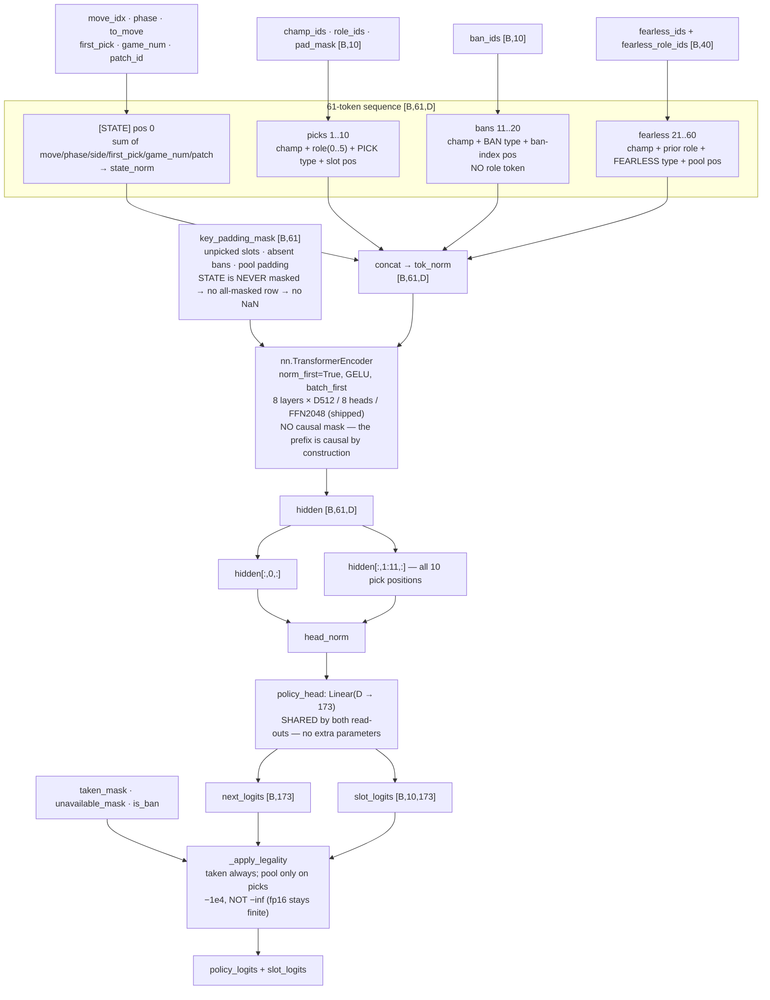
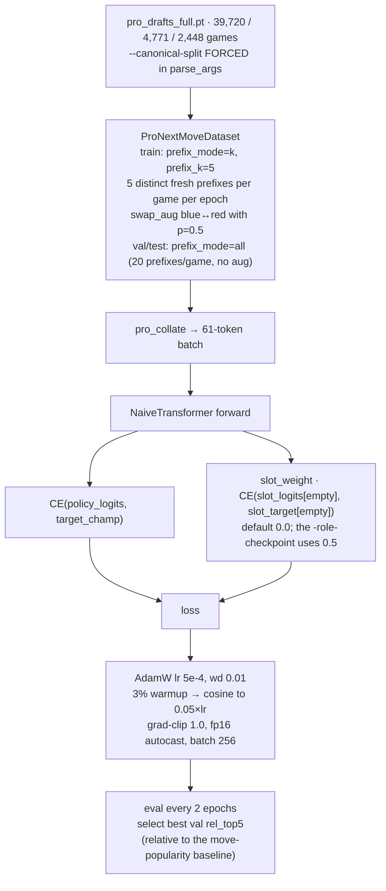

# `pro/model/naivetransformer/` — naive single-stack transformer

One uniform transformer over a **flat, prefix-only 61-token record**, plus a
single shared next-move head. The design question is not accuracy per se: it is
whether a single stack can recover, from the raw prefix, the structure that the
repo's two-tower encoder + separate policy head builds in by hand. No masked
pretraining, no causal attention mask, no value head, no role head — the
sequence is already causal because it only ever contains the prefix.

Results, paired comparisons and the task-by-task numbers live in
**`pro/model/test_split/REPORT_suite.md`** (and `logs/` here) — those are the
record. This file is about the architecture and running the folder.

## Architecture

`model.py::NaiveTransformer`. The sequence is **always 61 tokens**, in this
order:

```
index:  0        1..10        11..20        21..60
        [STATE] | 10 picks | 10 bans | 40 fearless-pool slots
```

Every token is a **sum of embeddings** (not a concatenation):

| token | composed of |
|---|---|
| pick slot `i` | `champ_emb(champ_ids[i]) + role_emb(clamp(role_ids[i],0..5)) + type_emb(PICK) + pick_pos(i)` |
| ban slot `i` | `champ_emb(ban_ids[i]) + type_emb(BAN) + ban_pos(i)` — **no role token** (bans have no role in the corpus) |
| fearless slot `i` | `champ_emb(fearless_ids[i]) + role_emb(clamp(fearless_role_ids[i],0..5)) + type_emb(FEARLESS) + fearless_pos(i)` |
| `[STATE]` | `move(20) + phase(4) + to_move(2) + first_pick(2) + game_num(6) + patch(n_patches)` embeddings, summed then `LayerNorm` |



Both read-outs exist on **every** forward pass. `policy_logits` (position 0)
answers the next move; `slot_logits` (the ten pick positions) is a
role-conditioned suggestion read-out that remains meaningful even when the
next real move is a ban. They share the same `policy_head`, so the slot head
adds **no parameters and no checkpoint change** (the role checkpoint records
this as `config.slot_head = "shared"`).

### What the code actually does, and the defaults that matter

- **Two different default sets — do not confuse them.** `NaiveTransformer.__init__`
  defaults to D768 / 12 layers / 12 heads / FFN3072; `train.py` overrides these
  to **D512 / 8 / 8 / FFN2048 / dropout 0.1** to fit an 8 GB card, and that is
  what both shipped checkpoints use (25,509,037 params). The constructor
  defaults are the scale-up knobs, not the model that was measured. The CLI
  flags can scale toward ~1B, which needs a much larger card and a smaller
  batch / sharded optimiser.
- **No causal mask and no masked-token stage.** The 61 tokens are built from
  the prefix only, so causal inference and causal training see identical
  inputs; there is no `[MASK]` token to maintain.
- **The state token is always attendable.** `src_key_padding_mask` removes
  unpicked slots, absent bans and pool padding, but never position 0 — so no
  row can be fully masked into NaN. `train.py::policy_loss` also replaces any
  non-finite logit row with zeros as a belt-and-braces guard.
- **`game_num` is optional and defensive.** With `--no-game-num` the term is
  skipped; older boards without a `game_num` key silently fall back to the
  `move_idx` value, clamped into range. A missing `patch_id` becomes 0.
- **Legality is applied to the logits, after the head.** `taken_mask` (picks +
  bans) is always masked; `unavailable_mask` (fearless pool) is masked on pick
  moves only for `policy_logits` (via `is_ban`), and unconditionally for
  `slot_logits`, because a role-slot query is always a pick. The constant is
  `ILLEGAL_LOGIT = -1e4`, not `-inf`, so fp16 autocast keeps the row finite.
- **The role-conditioned read-out is `slot_logits`**, produced on every
  forward pass and consumed by `eval_role.py` and the `role_next` suite.
- **No value head, no econ head, no role head.** Role placement at serve time
  comes from `data/champ_roles.json`, not from a model query.
- The `role_next` and `next_move` numbers describe the same weights answering
  **two different questions** — never pool them into one accuracy.

## Training



```bash
# plain next-move model (~7 min on one 8 GB card)
docker compose run --rm -T dev python pro/model/naivetransformer/train.py \
    --seed 0

# role-conditioned variant: fine-tune from the plain checkpoint with the
# auxiliary slot loss (the shipped -role- checkpoint, selected at epoch 8)
docker compose run --rm -T dev python pro/model/naivetransformer/train.py \
    --seed 0 --tag role-d512-l8-h8-k5 \
    --init-ckpt pro/model/checkpoints/nextpick-naivetransformer-d512-l8-h8-k5-through-lcp-df-sw/best.pt \
    --slot-loss-weight 0.5
```

`--canonical-split` is forced in `parse_args`, and `train()` refuses to start
unless the split is exactly 39,720 / 4,771 / 2,448. There is no flag to opt
into another split: a checkpoint from this folder is either comparable to the
nov13 models or does not exist. `--out-dir` must end in the corpus
through-suffix (`check_out_dir_name`); otherwise the run lands in
`pro/model/checkpoints/nextpick-naivetransformer-<tag>-<through>` by default.
`--epochs` sets `total_steps` and therefore the whole LR schedule, so two runs
with different epoch counts are different experiments, not reproductions.

## Checkpoints

Both live in `pro/model/checkpoints/` (weights are git-ignored) and carry
`config.arch == "naive_transformer"`, which is how `test_split/models.py`,
`test_split/registry.py` and `webapp/server.py` dispatch to this model
instead of guessing from weight names.

| directory | how it was trained | what it answers |
|---|---|---|
| `nextpick-naivetransformer-d512-l8-h8-k5-through-lcp-df-sw` | plain run, `--slot-loss-weight 0` (its config predates the `slot_head` keys) | `next_move`. The control for the role-conditioned query. |
| `nextpick-naivetransformer-role-d512-l8-h8-k5-through-lcp-df-sw` | `--slot-loss-weight 0.5`, initialised from the plain checkpoint, epoch 8 | `next_move` **and** `role_next` — the shipped next-move default for the frontend |

The suite scores every `nextpick-naivetransformer-*` checkpoint in both
`next_move` and `role_next` (one checkpoint, two tasks). On the canonical test
split (`n = 48,960` for `next_move`, `n = 24,480` for `role_next`):

| task | model | top-1 | top-5 |
|---|---|---|---|
| `next_move` | `nextpick-proonly-nov13-k5-…` (reference) | 18.9% | 50.8% |
| `next_move` | plain naive transformer | 20.6% | 54.1% (+1.7 pp, p 1e-25) |
| `next_move` | `-role-` naive transformer | 20.7% | 54.2% (+1.8 pp, p 5.3e-28) |
| `role_next` | `00-role-frequency-table` | 28.3% | 73.4% |
| `role_next` | plain naive transformer | 3.6% | 14.2% (untrained read-out) |
| `role_next` | `-role-` naive transformer | 24.4% | 64.7% |

The plain checkpoint's slot logits are near chance on `role_next` because
nothing trained them — the auxiliary slot loss is what makes the same head
useful there, and even then it stays below the frequency table. The paired
McNemar deltas and CIs are in `REPORT_suite.md`; read them there rather than
copying bare percentages.

## Evaluate it

```bash
# the canonical suite (add --only nextpick-naivetransformer-... to restrict)
docker compose run --rm -T dev python -m pro.model.test_split.suite --task next_move
docker compose run --rm -T dev python -m pro.model.test_split.suite --task role_next

# the folder's own role-conditioned diagnostic: every prefix × every empty slot
docker compose run --rm -T dev python pro/model/naivetransformer/eval_role.py \
    --ckpt pro/model/checkpoints/nextpick-naivetransformer-role-d512-l8-h8-k5-through-lcp-df-sw/best.pt
```

`eval_role.py` is **not** the `role_next` suite: it ranks the eventual occupant
of every empty slot at all 20 prefixes of every test game (320,688 states),
including ban states, against a train-only per-patch/per-role frequency
baseline. Its slices are nested and must not be summed. Its numbers are in
`logs/role_eval_plain.json` and `logs/role_eval_role.json`; do not pool them
with the suite's 10-states-per-game `role_next` numbers.

## Serving

`serve.py::NaiveTransformerPolicy` is the single adapter from a live frontend
board to the 61-token batch. It inherits everything but `next_move` from
`solo_queue.model.policy.infer.PolicyPredictor`, so the engine and
`/api/next-move` see the usual interface. Filled pick slots get their exact
role (`slot % 5`), empty ones get FLEX; the live board has no prior roles for
fearless-pool champions, so those get FLEX too. `next_move` returns
`roles: None` — role placement is data-driven, not from this model. `allowed=`
is applied to the logits before the top-k, the same as the other heads.

`webapp/server.py` loads this architecture via `NaiveTransformerPolicy` when
`config.arch == "naive_transformer"`, and the `-role-` checkpoint is the
shipped `POLICY_DEFAULT`. The served model is the one measured offline; the
adapter exists so the live board is not re-derived into a second model.

## Files

| file | what it does |
|---|---|
| `model.py` | `NaiveTransformer`: 61-token encoder, shared head, `_apply_legality`, checkpoint loaders |
| `train.py` | forced canonical split, prefix-k sampling + swap aug, slot-loss option, val `rel_top5` selection, `test_report.json` |
| `eval_role.py` | role-conditioned diagnostic on the canonical test split; writes `logs/role_eval_*.json` |
| `serve.py` | live-board → prefix-batch adapter; duck-types `PolicyPredictor` |
| `logs/` | committed `suite_compare.json` and the two role-eval reports |

## What not to change

- **The split or the prefix protocol.** The trainer forces the canonical split
  and 5 fresh prefixes/game/epoch; changing either makes the checkpoint
  incomparable to the recorded numbers.
- **The shared head.** The value of `slot_logits` is that it costs no
  parameters; a separate head would be a new checkpoint format.
- **`-1e4`, not `-inf`.** The whole reason the fp16 path stays finite.
- **The STATE-never-masked rule.** Masking it reintroduces NaN rows.
- **`config.arch`.** Loaders and the frontend dispatch on it; a rename would
  file the checkpoint into the wrong slot.
