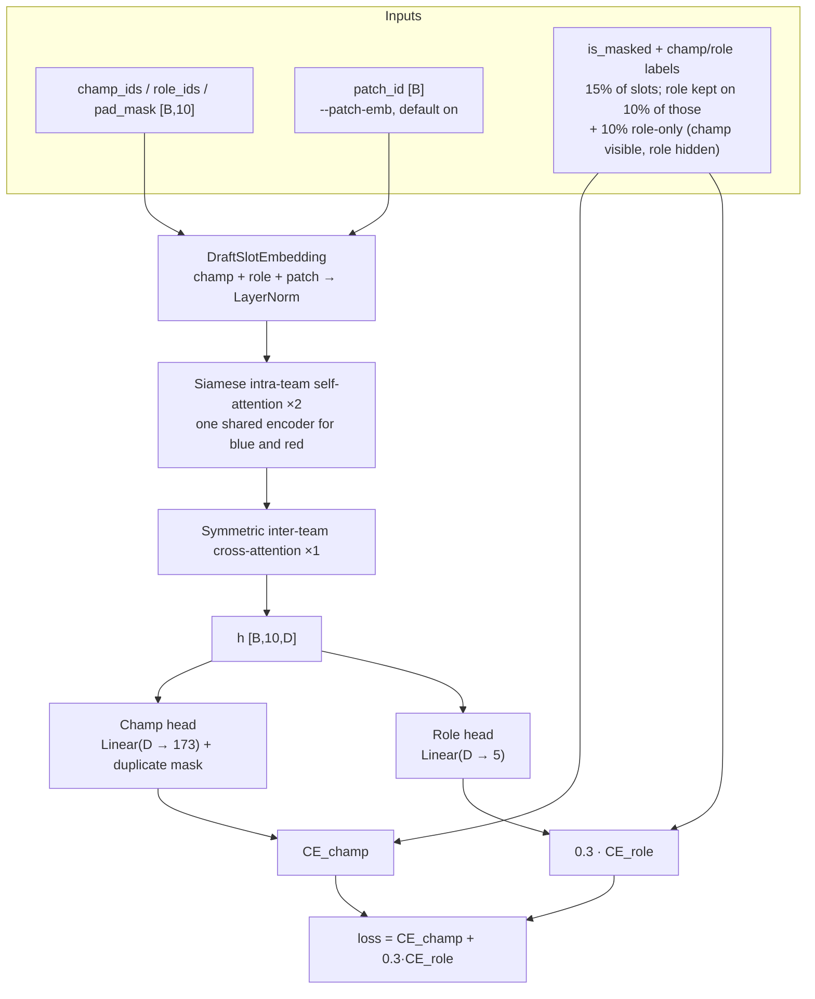
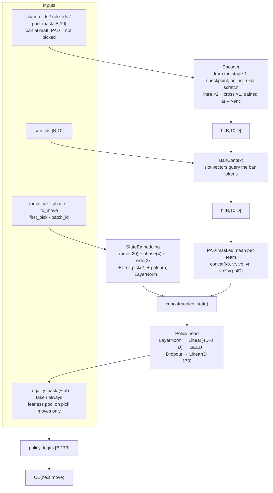
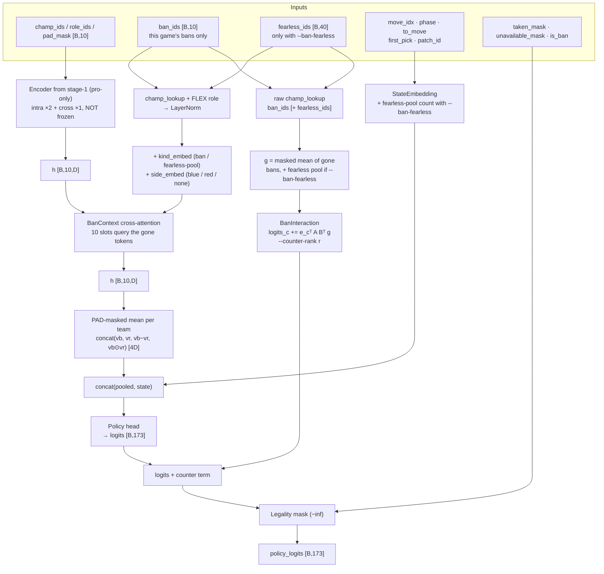

# `pro/model/proonly/` — pro-only draft model

The pro-only recipe: **pro drafts only, from scratch, no solo queue anywhere.**
Encoder D=256 / 2 intra + 1 cross / 8 heads, plus a patch embedding, trained on
a within-patch split where the patch is a *seen* input.

Results, ablations and the improvement plan live in **`STATUS.md`** at the repo
root — that is the single record. This file is only about running the folder.

## Architecture

Terminology, because "pool" is overloaded: **fearless pool** means the
champions already picked in earlier games of the series; **pooling / pooled**
means the set reduction (here a PAD-masked mean), never a champion set.

Two stages, both from scratch: `train_masked.py` builds a plain
`SiameseBase`; `train_policy.py` wraps that encoder in
`PolicyValueModel`. Neither stage has a soloQ checkpoint anywhere in its init.

### Stage 1 — masked completion (`train_masked.py`)



### Stage 2 — next move (`train_policy.py`)



What the code actually does, and the defaults that matter:

- **No value head and no econ head at all.** `train_policy.py` hardcodes
  `with_value=False` and `n_econ=0`, so those modules are never constructed —
  this is not "weight 0", it is absent from the checkpoint.
- **The encoder is not frozen here.** `set_freeze_encoder(False)` and two
  param groups: heads at `--lr` (1e-3) and the encoder at `--lr-enc`
  (1e-4 when initialised from a checkpoint, `--lr` when scratch). That is the
  opposite of `solo_queue/model/policy/`, which freezes the soloQ trunk by default.
- **`--patch-emb` is one flag for two tables**: it sizes both the encoder's
  patch embedding and the policy's `StateEmbedding` patch embedding, so there
  is no half-ablated state. The table is zero-initialised, so the two arms are
  bit-identical at step 0.
- **Stage 1 has no win path.** `cfg` writes `with_value: False`, `attr_dim: 0`;
  the model is D256 / 2 intra / 1 cross / 8 heads with `dropout 0.1` (not the
  soloQ 0.0 — 37k drafts against 2.5M parameters is the overfitting regime).
- **The ban switches exist but default off** (`--ban-side`, `--ban-fearless`,
  `--counter-rank 0`), so every checkpoint recorded before `exp/bans` is
  ban-blind; see `pro/model/bans/README.md`.
- Selection in stage 1 is `rel_champ_top5` on val, not raw top-5, because the
  raw number tracks how easy the window is and this window is much easier than
  the patch-honest one.

### Stage 2, ban-aware variant (`--ban-side --ban-fearless --counter-rank`)

The diagram above is the default path. The `exp/bans` branch adds three
off-by-default switches to the same `PolicyValueModel`; this is the same
forward pass with all three on.



What the switches actually change, in the order the diagram reads:

- **The encoder here is the pro-only stage-1 checkpoint, and it is not frozen.**
  `pro/model/bans/run_arms.sh` initialises every arm from
  `masking-proonly-randomvalsplit-through-wlds-ig-tes/best.pt` (D256, 2 intra +
  1 cross, no value head) and `train_policy.py` calls
  `set_freeze_encoder(False)`, exactly like the default path above. An earlier
  revision of this diagram read "SoloQ encoder (frozen), intra ×6 + cross ×3" —
  that was copied from `solo_queue/model/policy/` and is wrong for this branch: nothing in
  `exp/bans` touches soloQ data or freezes the trunk.
- **`ban_side`** adds a 3-row side embedding to the ban tokens (blue / red /
  none), derived as `BAN_SIDE_BY_SLOT ^ first_pick`. Your ban and the enemy's
  ban stop being the same fact. Zero-initialised.
- **`ban_fearless`** does two things: fearless-pool champions join the token
  set (`kind_embed`, `SIDE_NONE`), and the fearless-pool **count** enters
  `StateEmbedding`. This is the one switch that is not a no-op at step 0 — the
  tokens are real champion embeddings.
- **`counter_rank`** is independent of both: it reads the **raw**
  `champ_lookup` of `ban_ids`, plus `fearless_ids` only when `--ban-fearless`
  is also on, and adds `e_cᵀ A Bᵀ g` to the logits before legality. So
  "gone" for the counter term means *bans only* in the `--counter-rank 32`
  arm, and *bans + fearless pool* in the all-three arm.

The three together measured **+0.60 pp top-5** (p = 4.3e-8) against the
control, but each switch alone is flat (+0.08 counter, +0.11 fearless) — the
attribution is unresolved and the numbers live in `pro/model/bans/README.md`.

## What is here

| file | what it does |
|---|---|
| `common.py` | corpus/split/eval plumbing: `CORPORA`, `load_split`, `build_encoder`, `encoder_from_checkpoint`, `SliceAccumulator`, and the naming helpers `corpus_frontier` / `newest_train_series` / `through_suffix` / `check_out_dir_name` |
| `train_masked.py` | stage 1 — masked completion; from-scratch init, `--patch-emb` / `--no-patch-emb` toggles the patch embedding |
| `train_policy.py` | stage 2 — next-pick, initialised from stage 1 |
| `compare.py` | paired comparison of two checkpoints on identical rows (McNemar + game bootstrap + per-year) |
| `test_proonly.py` | 23 tests: patch id reaches the encoder, checkpoints round-trip, both trainers resolve the same split, the team-code table and its fallback, the `-through-` name, `--val-scope latest`, the seeded random-per-patch draw, and that `compare.py --split shared` really is val for both protocols |
| `ckpt/` | **local only** (git-ignored) — scratch runs from `--out-dir`-less invocations; the kept artefacts are in `model/checkpoints/` |
| `reports/` | every run's `test_report.json` and every paired comparison, committed |

## The checkpoints that are kept

The pro-only runs no longer live in `pro/model/proonly/ckpt/`. On 2026-11-03 every
checkpoint outside the soloQ pretrain was deleted and each model class was
retrained once into `model/checkpoints/<name>/`, where the name states the
inference and the stage:

| directory | stage | what it answers |
|---|---|---|
| `masking-proonly` | this folder's `train_masked.py` | masked completion, role board |
| `nextpick-proonly` | this folder's `train_policy.py` | next-move ranking |
| `masking-proonly-through-wlds-ig-tes` | `train_masked.py --no-test --val-scope latest` | the same, on all 46,879 drafts |
| `nextpick-proonly-through-wlds-ig-tes` | `train_policy.py`, init from the row above | the same, on all 46,879 drafts |
| `masking-proonly-randomvalsplit-through-wlds-ig-tes` | `train_masked.py --no-test --val-split random` | the same, val drawn at random per patch — **the shipped default** |
| `nextpick-proonly-randomvalsplit-through-wlds-ig-tes` | `train_policy.py`, init from the row above | the same — the next-move default until 2026-11-05 |
| `nextpick-proto-ensemble/ensemble.json` | `pro/model/proto/` (seeded 80/10/10 split) | mean of 3 members' logits — **the shipped next-move default** (`pro/model/proto/README.md` §6) |

**The `-through-<league>-<a>-<b>` suffix** states which series the training data
ends on. `--out-dir` is refused unless it ends with the suffix derived from the
corpus (`common.through_suffix`), so a retrain cannot land in an old directory
name and pass for the run it replaced. `through-wlds-ig-tes` is the Worlds 2026
final, Invictus Gaming vs Top Esports on 2026-11-04; the two team tags come from
`data/pro play/team_codes.json` and fall back to a deterministic initialism for
an unlisted org.

The suffix names the **corpus** frontier, not the last row the optimiser saw.
Under `--val-scope latest` the newest games are val rows, so the two differ;
`test_report.json` records both — `through` (corpus) and `train_through` (last row
in the train split, `WLDs|Gen.G|LYON|2026-10-25` for that pair). Under
`--val-split random` the draw usually leaves the frontier in train, so the two
coincide: the random-val pair's `train_through` *is* `WLDs|IG|TES|2026-11-04`.

The three runs this table used to list (`p-patch-s0`, `m-patch-s0`,
`p-nopatch-s0`) were the previous generation: `p-nopatch-s0` was the no-patch
ablation control and is gone with its weights, and the other two were replaced
by the retrain above. **Their numbers survive** in `reports/` and in `STATUS.md`
§4, but their paired comparisons can no longer be re-run. The current scores are
in `STATUS.md` §7 and `pro/model/test_split/REPORT_test_split_evaluation.md`. The six
pretrained-initialisation arms were moved to `solo_queue/model/finetune/` +
`solo_queue/model/policy/` — the pipeline is now where soloQ initialisation is studied, and
this folder is from-scratch only by design.

## Train it

```bash
# stage 1: masked completion (~8 min)
docker compose run --rm dev python pro/model/proonly/train_masked.py \
    --run-name masking-proonly --out-dir pro/model/checkpoints/masking-proonly --seed 0

# stage 2: next-pick, from that checkpoint (~13 min)
docker compose run --rm dev python pro/model/proonly/train_policy.py \
    --run-name nextpick-proonly --out-dir pro/model/checkpoints/nextpick-proonly \
    --seed 0 --init-ckpt pro/model/checkpoints/masking-proonly/best.pt --epochs 40
```

`--out-dir` is what gives the artefact its stable, self-describing name; without
it the run lands in `ckpt/run_<timestamp>_<name>/`, which the frontend would
list but nobody would be able to read.

Add `--no-patch-emb` to either for the ablation arm. The patch table is
zero-initialised, so the two arms are bit-identical at step 0.

`--epochs` is not only how long to train: it sets `total_steps`, and therefore
the whole learning-rate schedule (warmup is 3% of it, then a decay to zero).
At the default 40 epochs the warmup is 87 steps against 73 steps per epoch, so
the *first* epoch is spent ramping up; at 2 epochs it is 4 steps and the run
is at full LR almost immediately. Two runs of the same code, seed and data
therefore disagree at epoch 1 if the epoch counts differ — which makes a
shorter run look better and makes a re-run at a different `--epochs` a
*different experiment*, not a reproduction.

`--corpus all` switches to the wider 2017-2026 export (81,227 drafts, separate
cache file). It is **not** the default: `CSV_GLOB` is pinned to `202[2-9]_*` so
newly-arrived CSVs cannot silently swap the corpus out from under every
recorded number.

### Refreshing on all the data (`--no-test`, `--val-split random`)

```bash
# the shipped defaults: stage 1 (~7 min), then stage 2 (~14 min) from it
docker compose run --rm dev python pro/model/proonly/train_masked.py \
    --no-test --val-split random --seed 0 \
    --out-dir pro/model/checkpoints/masking-proonly-randomvalsplit-through-wlds-ig-tes
docker compose run --rm dev python pro/model/proonly/train_policy.py \
    --no-test --val-split random --seed 0 \
    --init-ckpt pro/model/checkpoints/masking-proonly-randomvalsplit-through-wlds-ig-tes/best.pt \
    --out-dir pro/model/checkpoints/nextpick-proonly-randomvalsplit-through-wlds-ig-tes
```

`--no-test` drops the pinned test split entirely. The pinned series become
ordinary rows, `test` is empty and the trainer says so instead of writing a
report of zeros. **The result has no held-out number.** Nothing in `STATUS.md` §7
describes these checkpoints; §7 belongs to the originals. What replaces the
held-out number is `compare.py --split shared` against an original — see below.

`--val-split random` changes *how* val is drawn, not how much: 10% of each patch,
but a seeded random draw of whole series instead of each patch's tail. Two
consequences, both wanted:

* the end of every patch is trained on (90% of each patch's timeline, including
  the games nearest the deployment date) instead of being the one slice the model
  never sees — under the tail split the *frontier* of every patch is val;
* the draw is per patch, `Random("%s|%s" % (VAL_SPLIT_SEED, patch))`, so one
  patch's val does not depend on which other patches exist or on iteration order,
  and `VAL_SPLIT_SEED` is a module constant rather than a flag because the masked
  and policy stages must draw the *same* series.

Split on 46,879 drafts: 42,121 train / 4,758 val / 0 test, 99 patches contributing
val. The masked stage still peaks early (rel 1.39x at epoch 6, 1.24x at 40) but
the epoch is now chosen on 8,053 masked slots instead of 78; the policy stage
selected epoch 40 and was still improving.

The earlier refresh, kept as a recorded experiment, is
`--no-test --val-scope latest --val-frac 0.20`: only the newest patch contributes
val, so every other patch is 100% train and 16.20 gives up 52 of its 262 rows
(210 trained). That is worth ~4,700 rows (42,100 → 46,827) and points the whole
selection signal at 16.20 — but at 52 games, 78 masked slots, the difference
between the selected epoch and the plateau was inside the noise. The random draw
is the same trade in the other direction: 4,758 val rows, and 236 of 16.20's 262
rows trained, including the four Worlds final games.

## Compare two checkpoints

```bash
# the two kept pro-only runs, masked vs policy
docker compose run --rm dev python pro/model/proonly/compare.py --task masked \
    --a pro/model/checkpoints/masking-proonly/best.pt \
    --b solo_queue/model/checkpoints/masking-finetune/best_mask.pt
docker compose run --rm dev python pro/model/proonly/compare.py --task policy \
    --a pro/model/checkpoints/nextpick-proonly/best.pt \
    --b solo_queue/model/checkpoints/nextpick-policy/best_policy.pt
```

Two checkpoints trained under *different splits* have no common val set, so
scoring one on the other's val decides the comparison by construction. `--split
shared` intersects them instead: rows that are val in both protocols, therefore
trained by neither. `--other` picks which protocol to intersect with.

```bash
# refresh vs original: 27 games, val for both, trained by neither
docker compose run --rm dev python pro/model/proonly/compare.py --task policy \
    --split shared --other old \
    --a pro/model/checkpoints/nextpick-proonly/best.pt \
    --b pro/model/checkpoints/nextpick-proonly-through-wlds-ig-tes/best.pt

# refresh vs an all-patch-val run (--other all), and exhaustive masking
docker compose run --rm dev python pro/model/proonly/compare.py --task masked \
    --split shared --other all --mask-mode slot \
    --a pro/model/checkpoints/masking-proonly-through-wlds-ig-tes/best.pt \
    --b pro/model/checkpoints/masking-proonly-allval-through-wlds-ig-tes/best.pt
```

`--mask-mode slot` hides each pick in turn (10 queries per game) instead of the
training objective's 15% random masking (~1.5), which is the protocol
`pro/model/test_split/eval_test_split.py` uses — so it reproduces §7 exactly, and it
is the only mode with enough queries to rank two models on 27 games. The verdict
that came out of these runs is in STATUS §7 ("Is the 16.20-only val helping or
hurting?").

The pruned arms (`p-patch-s0`, `p-nopatch-s0`, seed 1, the pretrained-init
six) can no longer be re-compared: their weights are gone and their numbers
live in `reports/`.

Both models are scored on the identical rows and the script asserts it, so the
delta is paired rather than two independent percentages.

## What not to change

* **The split.** `pipeline.split_within_patch` is why the patch embedding is
  worth anything. Under `split_series_by_date` every test patch is unseen, the
  patch id is `UNK` at test time, and the same input measured **−5.3 pp**.
* **The weighting.** Uniform, not the 75-day half-life the other stages use:
  the test window is the tail of *every* patch, so recency weighting would make
  old patches unlearnable and turn the metric into a statement about recency.
* **The patch table size.** `n_patches` is written into the checkpoint config
  and `load_encoder_state` refuses to invent or drop the table. A checkpoint
  trained with a patch table cannot be loaded into an encoder without one.

## Tests

```bash
docker compose run --rm -T dev python -m pytest pro/model/proonly/test_proonly.py -q
docker compose run --rm -T dev python -m pytest solo_queue/model/tests/test_patch_embed.py -q
docker compose run --rm -T dev python -m pytest "data/pro play/test_pipeline.py" -q
```

Run them per file: `solo_queue/model/policy/model.py` shadows `solo_queue/model/finetune/model.py`
under a single `pytest model/`.
