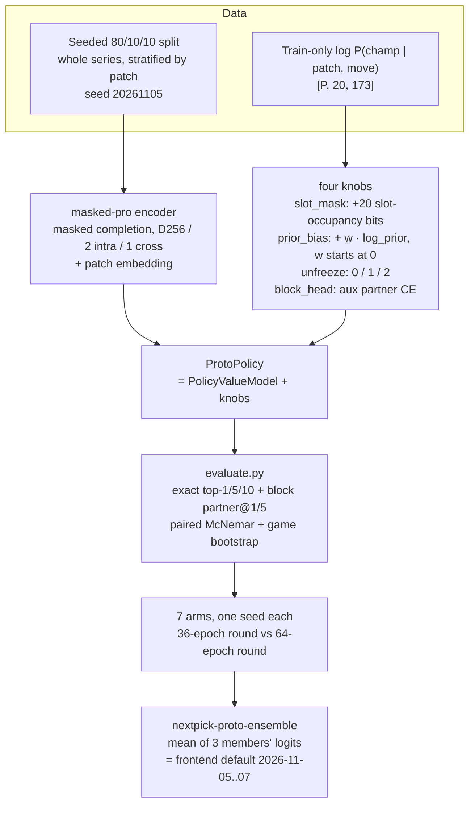

# Prototype sandbox — seeded split, one evaluator, seven arms

Purpose: rank ideas fast, on a split with enough test rows to actually rank
them, using the evaluation agreed on 2026-11-05 (exact move **and** block
partner). Nothing here writes to `pro/model/checkpoints/` and nothing here edits
`STATUS.md`; an idea that survives this directory is allowed to touch the kept
pipelines.

## 0. Shape of the thing

One encoder, one policy class, four knobs, one evaluator, and an ensemble at
the end.



- **Every arm starts from the same `runs/masked-pro` encoder** (2.49 M params,
  LOO top-5 0.724). The arms differ only in the knobs, so a delta is the knob.
- **The prior is a buffer, not a parameter.** `log_prior` is fit on train only;
  the learned part is a single scalar `prior_w` initialised to **0**, so the
  prior arm starts exactly at the baseline. Row 0 is the all-patch prior, which
  is what an unseen patch falls back to.
- **`slot_mask` changes the class, not just a flag.** It appends 20 binary
  features (10 pick slots + 10 ban slots) and widens the first layer, which is
  why `ProtoPolicy` exists — such a checkpoint cannot load into
  `PolicyValueModel`, and `strict=False` would produce a plausible wrong number.
- **`block_head` only makes sense with `--unfreeze`.** A frozen trunk cannot be
  shaped by an auxiliary loss, so the frozen arm would "show" the idea fails
  while nothing was learning.
- **`unfreeze` is not the same ladder as `solo_queue/model/policy/`.** Stage 1 re-freezes
  the embeddings *and* `intra_team`, so only the cross block moves; stage 2
  unfreezes everything, **embeddings included** (the production policy never
  unfreezes its embedding tables).
- **`ProtoPolicy` has its own `forward`.** It calls `ban_context` without
  kind/side ids and never adds the counter term, so the ban-awareness switches
  are not part of any arm in this directory.
- **The shipped artefact is a manifest, not a checkpoint.** `ensemble.json`
  names three members and the evaluator averages their **logits**; no single
  member beats the old default, so the gain is the averaging (3× inference).
- **This split is interpolation.** Test patches are in train, so the patch
  prior and patch embedding are at their most useful here and their least
  useful on a genuinely new patch; the date split remains the extrapolation
  check.

## 1. The split (`split.py`)

One seeded 80/10/10, shared by every stage, reproducible from `(seed, corpus)`.

| | train | val | test |
|---|---|---|---|
| pro drafts | 37,501 | 4,708 | 4,670 |
| pro series | 21,609 | 2,698 | 2,698 |
| patches touched | 106 | 105 | 105 |
| next-move states | 750,020 | 94,160 | **93,400** |
| soloQ drafts | 307,484 | 38,436 | 38,436 |

Seed `20261105`. Groups are **whole series**, never rows (fearless draft means
game 2 depends on game 1). Stratified by patch so the patch mix is identical
across splits — without that an arm can win by drawing newer patches. Draws are
per patch (`Random("<seed>|pro|<patch>")`), so adding a patch cannot reshuffle
another patch's assignment.

`data/splits/pro_seed20261105.json` stores the series ids themselves plus a
sha1 per split; `load()` rebuilds and **raises** if the hash moved, and verifies
the soloQ half too when given its row count. A corpus change is loud.

Why this split exists: the kept protocols (date split, within-patch split) both
answer temporal questions and both pay with a 7-game test split — 140 states,
a 95 % interval ~35 points wide. Every model-vs-model claim in STATUS had to be
made on val. Here the test split is **667× larger than the pinned one**.

**Cost, stated plainly:** test patches are in train, so this is interpolation,
not extrapolation. A patch embedding — and especially a patch-frequency prior —
is at its most useful here and at its least useful on a genuinely new patch.
The date split remains the extrapolation check; this split is the leaderboard.

## 2. The evaluator (`evaluate.py`)

* exact top-1/5/10 — the product question, comparable to the popularity table
* **block partner top-1/5** — at the first move of a same-team double-pick
  block, where does the champion the team takes *next* rank? Asked on the
  pre-legality distribution, the only place it is answerable.
* ban/pick and per-move slices
* paired McNemar + game-level bootstrap for two arms on identical rows
* `--ensemble` averages logits across checkpoints

Popularity baseline on this split (per-move table fitted on train):
top-1 0.0398, top-5 0.1520, top-10 0.2640 on test.

Block Jaccard was evaluated and **rejected**: it is ~0.82 × exact top-1 in every
grouping, and it structurally cannot forgive a swapped pair — if the model names
the partner at move *m*, both members are taken by *m+1*, so its second guess is
masked and `|P∩T|` can never reach 2. Swap rate 0.000 in 7,530 blocks.

## 3. Arms

All arms start from the same encoder (`runs/masked-pro`, masked completion on
the new train split, 2.49 M params, LOO top-5 0.724) and select on val top-5
over 1,200 val drafts. The test split is read once per arm, after the fact.

| arm | flags | val top-5 | test top-1 | test top-5 | partner@5 |
|---|---|---|---|---|---|
| base36 | — | 0.4893 | 0.1735 | 0.4846 | 0.3571 |
| slotmask36 | `--slot-mask` | 0.4879 | 0.1737 | 0.4841 | 0.3532 |
| prior36 | `--prior-bias` | 0.4899 | 0.1757 | 0.4875 | 0.3558 |
| unfreeze36 | `--unfreeze 1` | 0.4928 | 0.1764 | 0.4863 | 0.3582 |
| combo36 | all three | 0.4979 | 0.1794 | 0.4954 | 0.3532 |
| base64 | — | 0.5077 | 0.1828 | 0.5025 | 0.3605 |
| combo64 | all three | 0.5061 | 0.1850 | 0.5057 | 0.3565 |
| **ensemble(3)** | base64+combo64+unfreeze36 | — | **0.1907** | **0.5126** | **0.3696** |

### What the numbers say

**The schedule is the only lever that clearly worked.** 36 → 64 epochs is
+1.79 pp test top-5 on the identical recipe (paired p = 9.3e-67). Every
36-epoch arm was still improving at its last epoch, so the 36-epoch round was
measuring convergence speed, not quality.

**That invalidates the 36-epoch architecture result.** At 36 epochs `combo`
looked like +1.08 pp over base; at 64 epochs it is +0.32 pp. It converged
faster, it is not better. The single-arm lesson: **a fixed short budget ranks
arms by convergence speed.** Any arm that is "better" while every arm is still
climbing has to be re-run at convergence before it is believed.

**At convergence the ideas are small but not all zero.** `combo64` beats
`base64` by +0.32 pp top-5 (paired p = 0.0094, bootstrap [−0.0056, −0.0007])
and +0.22 pp top-1 (p = 0.039). The interval excludes zero, but the effect is
smaller than the 0.4–1.4 pp seed spread measured in STATUS §4, and this is one
seed per arm. **Suggestive, not established.**

**The partner metric moved independently, and not always with top-5.** The
ensemble is the only entry that improves all three (+0.91 pp partner@5 over
base64, +1.25 pp over base36), while `combo64` improves top-5 and is slightly
*worse* on partner@5 (p = 0.227). Exact-move accuracy and pair knowledge are
separable — which is the argument for keeping both metrics rather than a
composite.

**The ensemble is the largest single gain, measured against base64: +1.01 pp
top-5** (p = 1.3e-30), +0.79 pp top-1, +0.91 pp partner@5. Three members, no
tuning. It costs 3× inference, which for this workload is irrelevant.

### The three ideas are small, real-looking, and do not compose

Read the 36-epoch column against `base36` (negative delta in the logs means the
arm is better; all are paired on identical rows):

| idea | Δ top-5 vs base36 | p | verdict |
|---|---|---|---|
| `--slot-mask` | −0.05 pp | 0.64 | nothing |
| `--unfreeze 1` | +0.18 pp | 0.016 | small, below seed spread |
| `--prior-bias` | +0.29 pp | 0.004 | small, below seed spread |
| all three (`combo36`) | +1.08 pp | 1.5e-20 | see below |

`combo36`'s +1.08 pp is **convergence speed**, not quality: at 64 epochs the
same three flags are worth +0.32 pp. So the honest summary is that each idea is
worth roughly 0.2–0.3 pp and they are not additive — three independent small
effects that largely overlap in what they fix.

`--slot-mask` is the one that does nothing at all (0.4841 vs 0.4846). The
hypothesis was that the `_pool` step (PAD-masked mean) hides *which* roles are
filled; the pooled means plus `move_idx` evidently already carry enough.

`--prior-bias` is the interesting disappointment. Handing the model the
patch×move frequency table it keeps losing ban1 to gives it a visibly lower
train loss and only +0.29 pp on val: the patch embedding and the state
embedding already encode that table. Do not re-add it expecting ban1 to move.

`--unfreeze` was the obvious-looking bottleneck — 100 k trainable parameters of
3.35 M — and it is worth +0.18 pp. Freezing the trunk is not what limits this
model.

## 4. Reproduce

```bash
# split (writes data/splits/pro_seed20261105.json, verifies both halves)
docker compose run --rm -T dev python -c "
import sys, importlib.util; sys.path.insert(0,'.')
s=importlib.util.spec_from_file_location('pp','data/pro play/pipeline.py')
P=importlib.util.module_from_spec(s); s.loader.exec_module(P)
from pro.model.proto import split as S
rows,_=P.build_rows(); S.save(S.build(rows, soloq_n=384356)[1])"

# encoder, then arms (each ~9-17 min on one GPU)
docker compose run --rm -T dev python pro/model/proto/train_masked.py --name masked-pro --epochs 24
bash pro/model/proto/run_arms.sh      # 36-epoch round
bash pro/model/proto/run_arms2.sh     # 64-epoch confirmation

# test split, paired tests, and the ensemble
docker compose run --rm -T dev python pro/model/proto/evaluate.py --split test \
  --ckpt pro/model/proto/runs/base64/best.pt --name base64 \
  --ckpt pro/model/proto/runs/combo64/best.pt --name combo64
docker compose run --rm -T dev python pro/model/proto/evaluate.py --split test --ensemble \
  --ckpt pro/model/proto/runs/base64/best.pt --ckpt pro/model/proto/runs/combo64/best.pt \
  --ckpt pro/model/proto/runs/unfreeze/best.pt
```

Reports: `pro/model/proto/reports/test_arms.json`, `test_64.json`, `test_ens.json`.

## 5. What is not done

* **One seed per arm.** The +0.32 pp `combo64` margin needs a second seed before
  it is a claim; the ensemble margin does not, because it is measured against
  its own members on identical rows.
* **The soloQ half of the split is built and verified but unused.** The encoder
  is pro-only from scratch, so no arm consumed soloQ data. The established
  result (STATUS §4) is that a soloQ-initialised encoder is worth about +0.9 pp
  at the next-pick stage; that is a run nobody has spent yet, and it is the
  obvious next one.
* **Block-head arm never ran.** `--block-weight` is implemented (partner CE at
  the first move of a pair) but it needs `--unfreeze` to shape anything, and the
  unfreeze result above removed the reason to expect much.
* **The 64-epoch arms are still improving** (`combo64` peaked at its last
  epoch). The schedule is not converged, so the absolute numbers are a floor.

## 6. Promoted: the ensemble was the frontend's next-move default

**Superseded on 2026-11-07** by the ban-aware arm
(`nextpick-bans-aware-through-wlds-ig-tes`, `pro/model/bans/README.md`), which is
selectable-for-selectable a different model on a different comparison: +0.60 pp
top-5 against its own control on the *val* split. That number and the +1.33 pp
below are measured on different sets — val versus 439 rows neither model had
trained on — so they are not comparable and must not be added. The manifest is
kept, not deleted, and is still offered in the dropdown: its members are fixed
at three, so evicting one on a single seed would void the number that describes
it. Nothing below has changed.

`ensemble3` beat the checkpoint the frontend was serving, so it became the
default (`pro/model/checkpoints/nextpick-proto-ensemble/`). The comparison that
authorised it is not the test split above — the members and the old default were
trained on *different* splits, so neither side's own number is comparable. The
only honest common set is rows neither had seen:

| set | n | ensemble top-5 | shipped top-5 | delta |
|---|---|---|---|---|
| shipped_val x proto test (strict) | 439 drafts / 8,780 states | 0.5133 | 0.5000 | **+1.33 pp** [+0.64, +2.07], p = 2.6e-4 |

Top-1 +0.94 pp (p = .0036), top-10 +1.79 pp, block partner@5 +0.54 pp
(McNemar 98 vs 73, p = .067). **No single member is better than the old
default** (base64 +0.06 pp, p = .90; combo64 +0.33 pp, p = .44; unfreeze36
−1.49 pp, p = 5e-5) — the gain is the averaging, not a better member. That is
why the shipped artefact is the manifest and not a checkpoint, and why
`test_ensemble_manifest_is_still_servable` fails if someone "simplifies" it.

Reproduce with `python pro/model/proto/compare_shipped.py`. `shipped_val` is
reconstructed exactly (42,121/4,758/0, `pinned_test=None` — the pin would
otherwise remove 7 drafts from the candidate set and shift the draw); the script
refuses to run if the reconstruction does not match the checkpoint's recorded
`n`.

Two caveats travel with the default. 439 drafts separates +1.3 pp; it does not
resolve the members. And the ensemble costs 3× inference — irrelevant on CPU
here (13–15 MB per member), but it is a real cost if this ever serves traffic.
