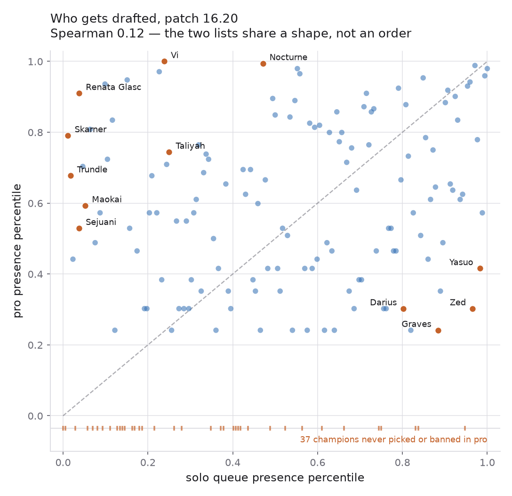
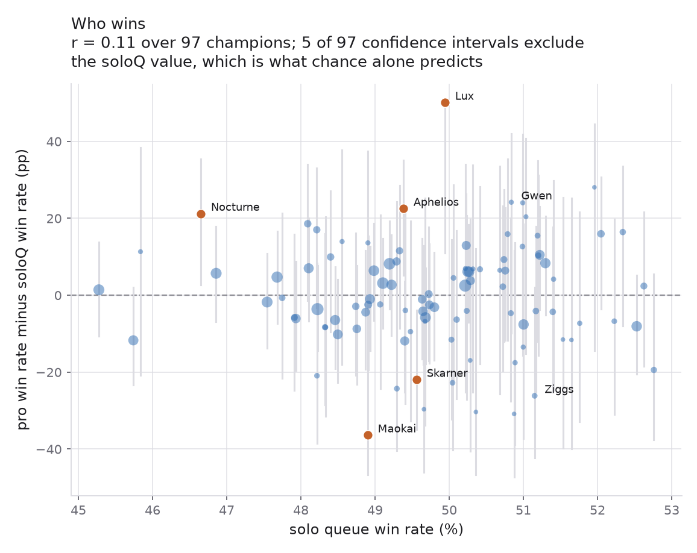
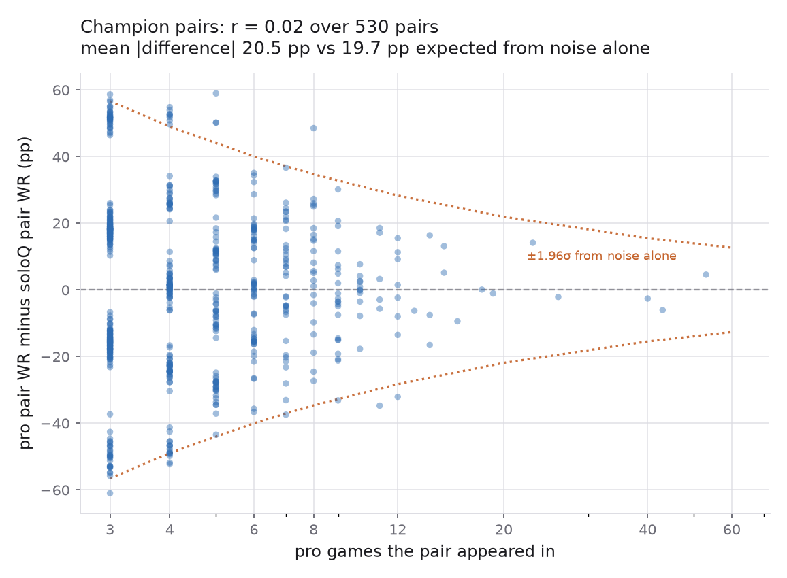
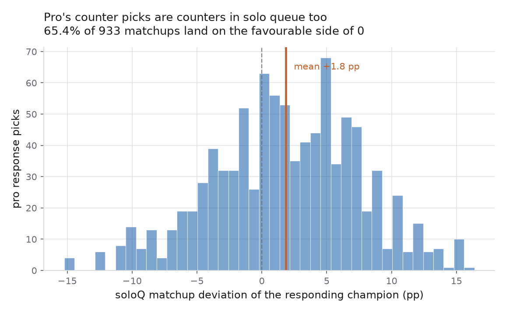

# Does the pro meta exist in solo queue?

**Patch 16.20 only — 262 pro drafts against 273,907 ranked solo queue games.**

Both populations are restricted to a single patch so no balance change sits
between them. 16.20 is the only patch where the two sides have real volume at
the same time: it is the last patch of the pro season (Worlds + the minor
leagues that ran alongside it) and the patch the solo queue crawl is almost
entirely made of.

Everything below is measured by `meta_overlap.py`; every number in this
document can be regenerated with one command (see *Reproducing* at the end).

---

## The short version

1. **Presence correlates weakly and honestly.** Pro and solo queue agree on
   *which* champions are contested at r = 0.22 (p = 0.014) — but that is mostly
   a shared bulk. At the top of the lists they diverge: of the 5 most-contested
   champions in each world, **1** is shared; of the top 10, **3**.
2. **Win rate does not transfer at all.** Across the 97 champions pro picked at
   least 5 times, the correlation between pro win rate and solo queue win rate
   is **r = 0.11** (p ≈ 0.27 against zero). The median correlation you would get
   if pro win rates were *literally* the solo queue numbers plus sampling noise
   is 0.116. The observation sits exactly on that null.
3. **Champion pairs are the same story, harder.** r = 0.02 over 530 pairs. The
   mean absolute difference between a pair's pro and solo queue win rate is
   **20.5 pp — against 19.7 pp expected from noise alone**.
4. **Pro counter picks *are* counters in solo queue, and it doesn't matter.**
   For 933 pro lane matchups, the champion picked *second* in the lane sits on
   the solo-queue-favourable side of the matchup by **+1.8 pp, in 65.4 % of
   cases**. Those same picks win **nothing extra** in pro (−1.8 pp, CI
   −4.8 to +1.1).
5. **The reason is sample size, not disagreement.** Pro win rates at this
   sample are so noisy (±12 pp for a typical champion) that "pro and solo queue
   disagree" and "pro and solo queue agree, but we cannot see it" are
   indistinguishable. The divergence that *is* visible is at the level of
   *selection* — who gets banned, who gets first-picked — not outcomes.

---

## 1. What is being compared

| | Pro | Solo queue |
|---|--:|--:|
| Source | Oracle's Elixir drafts, `data/pro play/pro_drafts.pt` | match-v5 crawl, `solo_queue/analysis/store/store.duckdb` |
| Games / drafts | 262 drafts | 273,907 games (queue 420, ≥ 5 min) |
| Team-drafts (the denominator) | 524 | 547,814 |
| Picks | 2,620 | 2,739,070 |
| Bans | 2,620 | 2,599,066 |
| Date range | 2026-10-09 → 2026-11-04 | 16.20 crawl |
| Leagues | LAS 140, WLDs 77, EM 26, TCL 10, HC 6, VCS 3 | — |

Definitions used throughout:

- **Presence** = (picks + bans) ÷ team-drafts. Both worlds ban 5 per side, so
  the two numbers are on the same scale. 100 % means "in every team's draft".
- **Win rate** = wins ÷ picks, per pick instance, never per game. The 10 picks
  in a game are not independent, so all intervals below are cluster-bootstrapped
  over drafts, not over picks.
- **Response pick** (the counter-pick definition) = a pick made after the enemy
  already filled that role. Every role has exactly one champion per side, so
  each role contributes exactly one *blind* pick (nobody had picked that role
  yet) and one *response* pick. 262 drafts → 1,310 of each, and the two halves
  partition all 2,620 picks. That is the cleanest control available: same games,
  same patch, only the order within the role differs.

What this comparison cannot do, stated up front:

- **Solo queue has no pick order.** match-v5 does not expose the draft sequence,
  so "counter pick" cannot be identified in solo queue at all. The solo queue
  side of the counter-pick question is therefore always *matchup* data —
  champion X in role R against champion Y in role R, whoever picked first. That
  is the right comparison anyway, but it means the solo queue number is not
  "what solo queue counter-pickers achieve", it is "how the matchup actually
  plays out".
- **Pro win rate is not champion strength.** It carries team quality, draft
  context, side and opponent strength. The two worlds measure different things
  even when they measure the same champion.
- **The pro sample is one league and a half.** LAS is 53 % of it. Dropping LAS
  and re-running the headline correlation gives r = 0.07 on 90 champions — the
  same answer, so the result is not a LAS artefact, but the sample is what it is.
- **262 drafts cannot resolve small effects.** For a single champion, ~2,200
  picks are needed to resolve a 3 pp win-rate difference at 80 % power. The
  most-picked champion on this patch has 74. Any per-champion statement in this
  report is therefore a description of these 262 drafts, not an estimate of
  champion strength.

---

## 2. Presence: the lists share a shape, not an order

The 15 most-contested champions on 16.20, both worlds:

| Champion | Pro pres | Pro pick | Pro ban | Pro WR | SoloQ pres | SoloQ pick | SoloQ ban | SoloQ WR |
|---|--:|--:|--:|--:|--:|--:|--:|--:|
| Vi | 40.5 % | 43 | 169 | 41.9 % | 2.2 % | 1.8 % | 0.4 % | 47.9 % |
| Nocturne | 39.5 % | 28 | 179 | 67.9 % | 3.9 % | 1.4 % | 2.5 % | 46.7 % |
| Lee Sin | 29.8 % | 68 | 88 | 57.4 % | 18.4 % | 7.7 % | 10.7 % | 49.2 % |
| Locke | 28.8 % | 38 | 113 | 63.2 % | 24.7 % | 5.1 % | 19.6 % | 50.2 % |
| Jarvan IV | 28.8 % | 67 | 84 | 52.2 % | 4.3 % | 3.7 % | 0.6 % | 49.1 % |
| Cassiopeia | 27.5 % | 45 | 99 | 46.7 % | 2.1 % | 1.3 % | 0.8 % | 49.8 % |
| Olaf | 27.3 % | 53 | 90 | 43.4 % | 4.3 % | 2.0 % | 2.3 % | 51.0 % |
| Qiyana | 27.1 % | 52 | 90 | 59.6 % | 23.9 % | 6.8 % | 17.1 % | 51.3 % |
| Syndra | 26.9 % | 74 | 67 | 52.7 % | 10.3 % | 5.0 % | 5.2 % | 50.2 % |
| Orianna | 24.8 % | 59 | 71 | 52.5 % | 1.9 % | 1.6 % | 0.2 % | 46.9 % |
| Lulu | 23.7 % | 57 | 67 | 43.9 % | 15.3 % | 7.3 % | 8.1 % | 49.7 % |
| Rumble | 23.5 % | 74 | 49 | 44.6 % | 1.6 % | 1.1 % | 0.5 % | 48.2 % |
| Caitlyn | 23.1 % | 35 | 86 | 40.0 % | 15.3 % | 6.0 % | 9.3 % | 48.8 % |
| Ezreal | 22.9 % | 60 | 60 | 46.7 % | 7.9 % | 5.7 % | 2.3 % | 45.3 % |
| Nautilus | 20.4 % | 56 | 51 | 55.4 % | 12.5 % | 5.5 % | 7.1 % | 49.0 % |

Correlations, over the champions that appear in both worlds:

| Measure | n | Pearson | Spearman | p (permutation) |
|---|--:|--:|--:|--:|
| Presence (pick + ban) | 136 | **0.218** | 0.124 | 0.014 |
| Pick rate only | 133 | **0.277** | 0.222 | — |
| Ban rate only | 111 | **0.245** | 0.136 | — |

So there is a real, weak, positive relationship — but it is a bulk relationship,
not a top-of-list one. Overlap at the top, against what a random 173-champion
draw would produce:

| Top-N | Shared | Expected by chance |
|---|--:|--:|
| 5 | **1** | 0.14 |
| 10 | **3** | 0.58 |
| 20 | **7** | 2.31 |
| 30 | **10** | 5.20 |



The shape of the divergence is consistent and has a clear flavour. Pro's
contested pool is *initiation and lane control*: Vi, Nocturne, Jarvan IV,
Skarner, Renata Glasc, Rumble, Orianna, Cassiopeia. Solo queue's is *solo
carry and skirmish*: Pyke (banned in 19.8 % of team-drafts, 2.9 % presence in
pro), Yasuo (13.5 % ban, 1.0 % pro), Zed (12.5 % ban, 0.4 % pro), Talon (9.9 %
ban, zero pro presence all patch), Sylas, Yone, Katarina.

Pro is also a much more concentrated draft environment — which is expected, and
is the reason a raw presence correlation cannot be read as agreement:

| | Distinct champs | Top-10 share | HHI |
|---|--:|--:|--:|
| Pro picks | 133 | 24.3 % | 0.0152 |
| SoloQ picks | 173 | 15.9 % | 0.0080 |
| Pro bans | 111 | 40.8 % | 0.0264 |
| SoloQ bans | 173 | 28.2 % | 0.0153 |

The bans are where the two metas are closest to being readable as the same
object (r = 0.245) — and also where the disagreements are most legible. Pro
banned Nocturne 179 times and Vi 169 times out of 524 team-drafts; solo queue
bans Nocturne in 2.5 % of team-drafts and Vi in 0.4 %. Going the other way,
Pyke and Yasuo are banned in 19.8 % and 13.5 % of solo queue team-drafts
(roughly 40 % and 27 % of games) and 1.9 % and 0 % of pro team-drafts.

---

## 3. Win rate: no measurable relationship

Across the 97 champions pro picked at least 5 times (and solo queue at least
2,000):

- Pearson **r = 0.114**, Spearman 0.135. A naive test of "no correlation at all"
  gives p ≈ 0.27, so it does not clear even the ordinary bar.
- Null ("pro win rate is the solo queue win rate plus binomial noise from 5–74
  picks"): median r = 0.116, 97.5th percentile 0.297, p = 0.515. The observation
  sits on the null median — the pro numbers are exactly as correlated with solo
  queue as pure sampling noise would make them. This is the more informative
  test of the two, because it asks the question the data can actually answer.
- **5 of 97** champions have a pro confidence interval that excludes their solo
  queue win rate. Under "the worlds agree", 5 % is what you expect. It is what
  we see.
- Dropping LAS: r = 0.070 on 90 champions. Same answer.



The five champions whose intervals do exclude the solo queue value are the ones
worth naming, because they are the only per-champion claims this sample can
support at all:

| Champion | Pro WR (n) | SoloQ WR | Gap |
|---|--:|--:|--:|
| Nocturne | 67.9 % (28) | 46.7 % | **+21.2** |
| Aphelios | 71.9 % (32) | 49.4 % | **+22.5** |
| Lux | 100 % (6) | 49.9 % | +50.1 |
| Maokai | 12.5 % (8) | 48.9 % | **−36.4** |
| Skarner | 27.6 % (29) | 49.6 % | **−22.0** |

Three of those five have 28–32 pro picks — the largest samples among them, and
the reason their intervals are tight enough to exclude anything at all. The
other two (Lux, 6 picks; Maokai, 8) escaped only because an extreme win rate
gets there faster.

The spread is worth stating in absolute terms, because it is what the null
comparison is fighting against:

| | Observed | Expected from noise alone |
|---|--:|--:|
| Mean absolute deviation, champions (n = 97) | **10.9 pp** | 9.9 pp |
| Mean absolute deviation, pairs (n = 530) | **20.5 pp** | 19.7 pp |

The median champion in this sample was picked 17 times, which is a ±12 pp
standard error. Nothing smaller than a 20-point true difference could show up.

---

## 4. Champion pairs

All 1,051 pairs that pro played at least twice are played in solo queue too —
none is absent. But "played" is doing a lot of work: 40 of them have fewer than
100 solo queue games, the median pro pair has 514, and only 255 clear 1,000.
The relationship between the two worlds' pair win rates is flat:

- **r = 0.020**, Spearman 0.016, over the 530 pairs with ≥ 3 pro games and
  ≥ 200 solo queue games.
- Mean pro pair WR 50.5 %, mean solo queue pair WR 48.6 %, mean |difference|
  **20.5 pp** against **19.7 pp** expected from noise.
- Pair *synergy* (pair WR minus the two champions' own average WR) correlates
  **−0.06** between worlds over 622 pairs. There is no such thing as a combo
  that is good in both worlds for the same reason.



The twelve most-played pro pairs, with the solo queue pair they map to:

| Pair | Pro n | Pro WR | SoloQ n | SoloQ WR | SoloQ games / 1k |
|---|--:|--:|--:|--:|--:|
| Kalista + Renata Glasc | 53 | 56.6 % | 2,250 | 52.0 % | 8.2 |
| Lucian + Milio | 43 | 41.9 % | 4,911 | 48.0 % | 17.9 |
| Lulu + Yunara | 40 | 47.5 % | 9,155 | 50.1 % | 33.4 |
| Karma + Ezreal | 26 | 42.3 % | 4,111 | 44.4 % | 15.0 |
| Ashe + Seraphine | 23 | 65.2 % | 3,016 | 51.1 % | 11.0 |
| Alistar + Jhin | 19 | 52.6 % | 1,850 | 53.7 % | 6.8 |
| Rakan + Xayah | 18 | 55.6 % | 3,172 | 55.5 % | 11.6 |
| Syndra + K'Sante | 16 | 37.5 % | 769 | 46.9 % | 2.8 |
| Thresh + Aphelios | 15 | 66.7 % | 4,603 | 53.6 % | 16.8 |
| Rumble + Qiyana | 15 | 60.0 % | 503 | 54.9 % | 1.8 |
| Alistar + Rumble | 14 | 35.7 % | 241 | 52.3 % | 0.9 |
| Nautilus + Kai'Sa | 14 | 64.3 % | 5,894 | 47.9 % | 21.5 |

Read the pro column as noise with a sign, not as a ranking: at n = 14, a 64.3 %
win rate is compatible with anything from 39 % to 84 %. The two rows worth
looking at are the ones where the worlds point opposite ways *and* the solo
queue side has real volume behind it — Nautilus + Kai'Sa (64.3 % in 14 pro
games, 47.9 % in 5,894 solo queue games) and Syndra + K'Sante (37.5 % in 16,
46.9 % in 769). Nautilus + Kai'Sa is a plain bot-lane duo, so the two reads
genuinely conflict; Syndra + K'Sante is a mid-plus-top pair, so pro may be
buying the pairing's draft value (two flex threats) rather than lane synergy,
which solo queue would never price in. Either way, both differences are the
size a 14–16 game sample produces on its own.

---

## 5. Counter picks: the champion transfers, the win does not

This is the most interesting result in the report, and it goes in two
directions.

### 5a. In pro, answering in a lane does not win more

| | Picks | Win rate | 95 % CI |
|---|--:|--:|--|
| Blind (first to that role), pooled | 1,310 | 51.4 % | — |
| Response (answered the role), pooled | 1,310 | 48.6 % | — |
| **Within-side contrast** | 2,620 | **−1.84 pp** | **[−4.82, +1.11]** |

The within-side contrast is the number to trust: blue wins 56.1 % of these 262
drafts and red is the side that answers more often (704 of 1,310 response
picks), so the pooled comparison mostly re-measures the side effect. Broken
out, blue answers at 55.1 % against a 57.0 % blind rate, and red answers at
43.0 % against 44.9 % — the same −1.84 pp on both sides, which is algebraic
rather than lucky: each role gives one side a blind pick and the other a
response pick, so the two sides' contrasts are the same expression.

**There is no measurable counter-pick win advantage in pro on 16.20.** The
point estimate is negative, and the interval excludes anything better than
+1.1 pp.

### 5b. But pro's counters are real counters by solo queue's reckoning

For each response pick whose solo queue matchup cell is thick enough (≥ 200
games in that exact role, and both champions thick enough overall to compute the
deviation — 933 of 1,310 picks clear the bar), the question is whether the
matchup pro created is favourable in solo queue too. Measured antisymmetrically,
so the champion pool cannot bias it:

```
dev(X vs Y, role R) = (wr(X|Y) − wr(X)) − (wr(Y|X) − wr(Y))
```

This flips sign when the two sides swap, so it is a property of the *matchup*,
not of the champions pro happens to like. Results over 933 response picks:

| | Value | 95 % CI |
|---|--:|--|
| Solo queue WR of the responding champion in that cell | 51.16 % | [50.94, 51.39] |
| Matchup edge vs the champion's own solo queue WR | +1.47 pp | [+1.27, +1.68] |
| **Antisymmetric matchup deviation** | **+1.84 pp** | **[+1.46, +2.22]** |
| Cells on the favourable side of 0 | **65.4 %** | — |



Pro teams, on this patch, pick the champion that solo queue also says wins the
lane. Not marginally — two thirds of the time, worth about 1.8 points of win
rate in solo queue terms. The blind picker gets the mirror image (−1.84 pp by
construction, 34.6 % favourable), which is the same statement read backwards.

### 5c. The two facts together

If pro's counter picks were translating, the responding team would win more.
It wins 1.8 pp *less*. The individual cells show the same gap from the other
angle:

- Cells where pro's response pick **won** (n = 453): solo queue WR 51.37 %.
- Cells where it **lost** (n = 480): solo queue WR 50.96 %.
- Difference: **0.41 pp** — the pro result carries almost none of the solo
  queue matchup information.
- Pro's *successful* counters (≥ 3 games, ≥ 60 % WR, 54 cells): 51.6 % in solo
  queue. Pro's *failed* counters (≥ 3 games, ≤ 40 % WR, 62 cells): 50.9 %.

The thickest cells in pro, with the solo queue verdict next to them. These are
listed because they are the cells a reader would naturally want to check, not
because they are the test — several have only 67–191 solo queue games, so their
solo queue numbers are themselves ±7 pp:

| Response pick | Role | vs | Pro n | Pro WR | SoloQ n | SoloQ WR |
|---|---|--:|--:|--:|--:|--:|
| K'Sante | TOP | Rumble | 17 | 64.7 % | 191 | 46.6 % |
| Galio | TOP | Rumble | 16 | 50.0 % | 67 | 52.2 % |
| Taliyah | MID | Ryze | 13 | 76.9 % | 77 | 51.9 % |
| Ambessa | TOP | Rumble | 13 | 53.8 % | 163 | 50.3 % |
| Skarner | JNG | Lee Sin | 13 | 7.7 % | 355 | 50.4 % |
| Syndra | MID | Cassiopeia | 11 | 63.6 % | 189 | 51.3 % |
| Xin Zhao | JNG | Jarvan IV | 11 | 45.5 % | 232 | 53.9 % |
| Caitlyn | BOT | Yunara | 11 | 45.5 % | 2,099 | 51.5 % |
| Alistar | SUP | Nautilus | 11 | 27.3 % | 1,134 | 57.0 % |
| Nautilus | SUP | Karma | 10 | 70.0 % | 1,290 | 53.6 % |
| Wukong | JNG | Jarvan IV | 10 | 50.0 % | 717 | 51.3 % |
| Karma | SUP | Lulu | 10 | 20.0 % | 2,024 | 47.9 % |

Skarner into Lee Sin is the cleanest illustration of the whole report: 13 pro
games, 1 win, and a solo queue cell (355 games) that says the matchup is
completely even. Alistar into Nautilus is the reverse — 3 pro wins in 11, and
the single most lopsided cell in the table (57.0 % over 1,134 games). Neither
pro number is evidence of anything except that 10-game samples are 10-game
samples.

Why might the lane edge not convert? This sample cannot answer it, but the
plausible mechanisms are visible in the data: pro's response picks are
concentrated in the lanes where pro can afford a narrow champion (top and
support are 6 of the 12 thickest cells above), and a narrow lane counter costs
a draft slot that the opponent then uses on the mid/jungle pairing that decides
the game. The solo queue edge is a 1v1 property; pro games are not decided 1v1.

---

## 6. Secondary finding: role portability is high

Of the 116 champions pro used at least twice, **105 play the same role in solo
queue as their most common pro role**. The 11 that do not are almost all
pro-specific flexes:

| Champion | Pro role (games) | SoloQ dominant role |
|---|---|--|
| Maokai | JNG (8) | SUP 64 % |
| Pantheon | JNG (35) | TOP 43 % |
| Trundle | JNG (15) | TOP 62 % |
| Yasuo | TOP (5) | MID 57 % |
| Diana | MID (5) | JNG 54 % |
| Vayne | TOP (8) | BOT 61 % |
| Yone | MID (11) | TOP 50 % |
| Zed | JNG (2) | MID 68 % |
| Smolder | MID (2) | BOT 85 % |
| Kog'Maw | MID (5) | BOT 69 % |
| Malphite | JNG (4) | TOP 85 % |

This matters for the sections above: the counter-pick analysis matches on
pro's *actual* role, and for most of these the pro role is one the champion
barely plays in solo queue (Maokai jungle, Trundle jungle, Malphite jungle,
Smolder mid, Kog'Maw mid), so their solo queue matchup cells in that role are
thin and fall out of the 933 under the ≥ 200-game floor. It is also the one
place where the pro read is visibly ahead of solo queue: pro plays Pantheon
jungle 35 times, while solo queue still puts him top most often (43 % of his
games).

---

## 7. What would change the answer

The null result on win rates is not "pro and solo queue are different". It is
"262 drafts cannot tell". Concretely:

- **Per champion**, ~2,200 picks are needed to resolve a 3 pp difference. The
  current maximum is 74. Nothing short of ~30 patches pooled, or a much wider
  league net, gets there.
- **Per matchup**, the 933 response picks collapse into 409 distinct
  (champion, role, opponent) cells, and 229 of those hold a single pro game —
  the median is 1, the maximum 13. The transfer test works only because it
  aggregates all 409; the individual cells never will.
- **Team strength** is the largest known confound on the pro side and is
  untreated here. `exp/win-prediction` measured team-only information at
  0.648 log loss against 0.688 for draft-only, i.e. the roster explains more of
  a pro game than the draft does. Any per-champion pro win rate is therefore
  mostly a statement about which teams picked that champion.
- **Pooling patches** is the obvious next step and it is half-done already: the
  pro corpus covers 106 patches and 46,879 drafts. The blocker is on the solo
  queue side, where the store currently holds two patches (16.19 and 16.20) and
  would need the crawl extended. The cost is that champion strength moves
  between patches, so a pooled correlation would measure "average" transfer
  rather than transfer on one balance state.

The one result here that is *not* power-limited is 5b: the +1.84 pp matchup
deviation over 933 cells with a cluster-bootstrap interval of [1.46, 2.22] is a
real, well-measured fact about how pro drafts answer lanes. It is the part of
this report worth remembering.

---

## Appendix — every champion on 16.20

All 173 champions, sorted by pro presence. `pres` = (picks + bans) ÷
team-drafts, so 100 % would mean "in every team's draft"; pro has 524
team-drafts, solo queue has 547,814. Win rates are per pick, with Wilson 95 %
intervals. A dash means the champion was never picked in that world (37
champions were never picked *or* banned in pro on this patch; they are the rows
from Talon down, ordered by how much solo queue plays them).

| Champion | Pro pres | Pro pick | Pro ban | Pro WR | 95% CI | SoloQ pres | SoloQ pick | SoloQ ban | SoloQ WR | 95% CI |
|---|--:|--:|--:|--:|--|--:|--:|--:|--:|--|
| Vi | 40.5% | 43 | 169 | 41.9% | 28.4%-56.7% | 2.2% | 1.8% | 0.4% | 47.9% | 47.0%-48.9% |
| Nocturne | 39.5% | 28 | 179 | 67.9% | 49.3%-82.1% | 3.9% | 1.4% | 2.5% | 46.7% | 45.6%-47.8% |
| Lee Sin | 29.8% | 68 | 88 | 57.4% | 45.5%-68.4% | 18.4% | 7.7% | 10.7% | 49.2% | 48.7%-49.7% |
| Locke | 28.8% | 38 | 113 | 63.2% | 47.3%-76.6% | 24.7% | 5.1% | 19.6% | 50.2% | 49.6%-50.8% |
| Jarvan IV | 28.8% | 67 | 84 | 52.2% | 40.5%-63.7% | 4.3% | 3.7% | 0.6% | 49.1% | 48.4%-49.8% |
| Cassiopeia | 27.5% | 45 | 99 | 46.7% | 32.9%-60.9% | 2.1% | 1.3% | 0.8% | 49.8% | 48.6%-51.0% |
| Olaf | 27.3% | 53 | 90 | 43.4% | 31.0%-56.7% | 4.3% | 2.0% | 2.3% | 51.0% | 50.1%-51.9% |
| Qiyana | 27.1% | 52 | 90 | 59.6% | 46.1%-71.8% | 23.9% | 6.8% | 17.1% | 51.3% | 50.8%-51.8% |
| Syndra | 26.9% | 74 | 67 | 52.7% | 41.5%-63.7% | 10.3% | 5.0% | 5.2% | 50.2% | 49.6%-50.8% |
| Orianna | 24.8% | 59 | 71 | 52.5% | 40.0%-64.7% | 1.9% | 1.6% | 0.2% | 46.9% | 45.8%-47.9% |
| Lulu | 23.7% | 57 | 67 | 43.9% | 31.8%-56.7% | 15.3% | 7.3% | 8.1% | 49.7% | 49.2%-50.2% |
| Rumble | 23.5% | 74 | 49 | 44.6% | 33.8%-55.9% | 1.6% | 1.1% | 0.5% | 48.2% | 47.0%-49.5% |
| Caitlyn | 23.1% | 35 | 86 | 40.0% | 25.6%-56.4% | 15.3% | 6.0% | 9.3% | 48.8% | 48.2%-49.3% |
| Ezreal | 22.9% | 60 | 60 | 46.7% | 34.6%-59.1% | 7.9% | 5.7% | 2.3% | 45.3% | 44.7%-45.8% |
| Nautilus | 20.4% | 56 | 51 | 55.4% | 42.4%-67.6% | 12.5% | 5.5% | 7.1% | 49.0% | 48.4%-49.6% |
| Lucian | 20.0% | 50 | 55 | 42.0% | 29.4%-55.8% | 6.5% | 5.3% | 1.2% | 48.5% | 47.9%-49.0% |
| Renata Glasc | 20.0% | 55 | 50 | 56.4% | 43.3%-68.6% | 1.2% | 1.0% | 0.2% | 50.2% | 48.9%-51.6% |
| Akali | 19.8% | 36 | 68 | 44.4% | 29.5%-60.4% | 13.3% | 4.2% | 9.0% | 48.9% | 48.2%-49.5% |
| Kalista | 19.1% | 55 | 45 | 56.4% | 43.3%-68.6% | 4.0% | 2.8% | 1.1% | 50.3% | 49.5%-51.1% |
| K'Sante | 17.7% | 59 | 34 | 45.8% | 33.7%-58.3% | 4.3% | 2.6% | 1.7% | 47.5% | 46.7%-48.4% |
| Jayce | 17.6% | 49 | 43 | 55.1% | 41.3%-68.1% | 12.1% | 5.3% | 6.9% | 48.1% | 47.5%-48.7% |
| Jhin | 16.2% | 52 | 33 | 51.9% | 38.7%-64.9% | 9.5% | 8.7% | 0.8% | 49.2% | 48.8%-49.7% |
| Karma | 15.3% | 47 | 33 | 38.3% | 25.8%-52.6% | 6.5% | 4.6% | 1.9% | 48.5% | 47.9%-49.1% |
| Ambessa | 14.7% | 63 | 14 | 52.4% | 40.3%-64.2% | 6.7% | 3.1% | 3.6% | 47.7% | 46.9%-48.4% |
| Wukong | 14.5% | 47 | 29 | 61.7% | 47.4%-74.2% | 6.5% | 4.1% | 2.5% | 51.2% | 50.6%-51.9% |
| Seraphine | 14.5% | 31 | 45 | 58.1% | 40.8%-73.6% | 5.5% | 3.4% | 2.0% | 49.3% | 48.6%-50.0% |
| Galio | 14.1% | 36 | 38 | 47.2% | 32.0%-63.0% | 4.0% | 3.0% | 1.0% | 49.7% | 49.0%-50.5% |
| Poppy | 13.5% | 11 | 60 | 63.6% | 35.4%-84.8% | 4.2% | 1.5% | 2.7% | 51.0% | 49.9%-52.1% |
| Viktor | 13.4% | 37 | 33 | 54.1% | 38.4%-69.0% | 14.0% | 6.4% | 7.7% | 50.3% | 49.8%-50.8% |
| Ryze | 13.4% | 50 | 20 | 34.0% | 22.4%-47.8% | 1.8% | 1.5% | 0.2% | 45.7% | 44.7%-46.8% |
| Alistar | 12.8% | 54 | 13 | 44.4% | 32.0%-57.6% | 4.8% | 3.5% | 1.4% | 52.5% | 51.8%-53.2% |
| Pantheon | 12.2% | 35 | 29 | 48.6% | 33.0%-64.4% | 5.1% | 3.9% | 1.2% | 49.6% | 49.0%-50.3% |
| Bard | 11.3% | 28 | 31 | 46.4% | 29.5%-64.2% | 4.9% | 3.0% | 1.9% | 48.9% | 48.1%-49.7% |
| Xin Zhao | 11.1% | 40 | 18 | 37.5% | 24.2%-53.0% | 1.3% | 1.1% | 0.2% | 49.4% | 48.2%-50.6% |
| Milio | 10.7% | 48 | 8 | 47.9% | 34.5%-61.7% | 5.5% | 3.5% | 2.0% | 48.9% | 48.2%-49.6% |
| Renekton | 10.7% | 15 | 41 | 46.7% | 24.8%-69.9% | 5.3% | 3.0% | 2.3% | 49.1% | 48.3%-49.8% |
| Skarner | 10.1% | 29 | 24 | 27.6% | 14.7%-45.7% | 1.1% | 0.9% | 0.1% | 49.6% | 48.2%-50.9% |
| Yunara | 9.7% | 44 | 7 | 45.5% | 31.7%-59.9% | 10.3% | 6.0% | 4.3% | 49.6% | 49.1%-50.2% |
| Sylas | 8.8% | 24 | 22 | 45.8% | 27.9%-64.9% | 18.7% | 8.6% | 10.1% | 48.7% | 48.3%-49.2% |
| Camille | 8.4% | 23 | 21 | 60.9% | 40.8%-77.8% | 5.5% | 3.8% | 1.7% | 49.3% | 48.7%-50.0% |
| Aphelios | 8.0% | 32 | 10 | 71.9% | 54.6%-84.4% | 6.5% | 4.6% | 1.8% | 49.4% | 48.8%-50.0% |
| Gnar | 8.0% | 24 | 18 | 66.7% | 46.7%-82.0% | 2.8% | 1.9% | 0.8% | 48.1% | 47.1%-49.0% |
| Naafiri | 7.6% | 24 | 16 | 58.3% | 38.8%-75.5% | 6.2% | 1.9% | 4.2% | 48.4% | 47.4%-49.4% |
| Kai'Sa | 7.4% | 28 | 11 | 50.0% | 32.6%-67.4% | 11.1% | 9.5% | 1.6% | 49.7% | 49.3%-50.2% |
| Taliyah | 7.3% | 25 | 13 | 68.0% | 48.4%-82.8% | 2.3% | 2.0% | 0.3% | 52.0% | 51.1%-53.0% |
| Rakan | 6.9% | 28 | 8 | 57.1% | 39.1%-73.5% | 2.8% | 2.6% | 0.2% | 50.8% | 49.9%-51.6% |
| Jax | 6.7% | 16 | 19 | 43.8% | 23.1%-66.8% | 9.7% | 3.4% | 6.4% | 50.1% | 49.4%-50.8% |
| Ashe | 6.5% | 23 | 11 | 65.2% | 44.9%-81.2% | 2.9% | 2.4% | 0.4% | 48.2% | 47.4%-49.1% |
| Neeko | 6.5% | 11 | 23 | 54.5% | 28.0%-78.7% | 1.6% | 1.3% | 0.4% | 50.1% | 48.9%-51.2% |
| Ahri | 5.9% | 17 | 14 | 47.1% | 26.2%-69.0% | 5.9% | 4.7% | 1.2% | 51.2% | 50.6%-51.8% |
| Varus | 5.7% | 19 | 11 | 42.1% | 23.1%-63.7% | 2.2% | 1.8% | 0.4% | 47.9% | 46.9%-48.9% |
| Annie | 5.3% | 12 | 16 | 66.7% | 39.1%-86.2% | 1.2% | 1.0% | 0.2% | 50.8% | 49.5%-52.1% |
| Zeri | 5.2% | 17 | 10 | 52.9% | 31.0%-73.8% | 3.6% | 3.0% | 0.6% | 50.7% | 50.0%-51.5% |
| Xayah | 5.2% | 20 | 7 | 55.0% | 34.2%-74.2% | 3.3% | 2.9% | 0.4% | 52.6% | 51.9%-53.4% |
| Aurora | 5.0% | 20 | 6 | 60.0% | 38.7%-78.1% | 2.8% | 2.2% | 0.7% | 50.7% | 49.8%-51.6% |
| Corki | 4.8% | 17 | 8 | 47.1% | 26.2%-69.0% | 2.1% | 1.9% | 0.2% | 47.7% | 46.8%-48.7% |
| Trundle | 4.8% | 15 | 10 | 40.0% | 19.8%-64.3% | 1.1% | 0.9% | 0.1% | 48.3% | 47.0%-49.7% |
| Cho'Gath | 4.6% | 13 | 11 | 38.5% | 17.7%-64.5% | 7.9% | 4.9% | 3.1% | 50.0% | 49.4%-50.6% |
| Vayne | 4.6% | 8 | 16 | 62.5% | 30.6%-86.3% | 3.9% | 2.1% | 1.9% | 48.6% | 47.6%-49.5% |
| LeBlanc | 4.4% | 8 | 15 | 37.5% | 13.7%-69.4% | 13.1% | 3.1% | 10.0% | 51.0% | 50.2%-51.7% |
| Sivir | 4.4% | 11 | 12 | 45.5% | 21.3%-72.0% | 3.1% | 2.1% | 0.9% | 49.4% | 48.5%-50.3% |
| Tristana | 4.2% | 17 | 5 | 47.1% | 26.2%-69.0% | 11.2% | 6.2% | 4.9% | 51.4% | 50.9%-51.9% |
| Draven | 4.0% | 8 | 13 | 75.0% | 40.9%-92.9% | 13.2% | 2.7% | 10.5% | 51.0% | 50.2%-51.8% |
| Leona | 4.0% | 12 | 9 | 66.7% | 39.1%-86.2% | 6.2% | 3.5% | 2.7% | 51.2% | 50.5%-51.9% |
| Thresh | 3.6% | 16 | 3 | 68.8% | 44.4%-85.8% | 14.4% | 7.8% | 6.5% | 52.3% | 51.9%-52.8% |
| Anivia | 3.6% | 9 | 10 | 33.3% | 12.1%-64.6% | 3.4% | 2.0% | 1.4% | 50.9% | 49.9%-51.8% |
| Yone | 3.4% | 11 | 7 | 27.3% | 9.7%-56.6% | 14.3% | 8.3% | 5.9% | 50.0% | 49.6%-50.5% |
| Hecarim | 3.4% | 7 | 11 | 57.1% | 25.0%-84.2% | 10.8% | 3.6% | 7.2% | 50.3% | 49.6%-51.0% |
| Yorick | 3.4% | 11 | 7 | 27.3% | 9.7%-56.6% | 2.8% | 1.1% | 1.7% | 48.2% | 46.9%-49.5% |
| Rell | 3.2% | 15 | 2 | 33.3% | 15.2%-58.3% | 3.7% | 2.8% | 0.9% | 52.8% | 52.0%-53.6% |
| Maokai | 3.1% | 8 | 8 | 12.5% | 2.2%-47.1% | 1.3% | 1.2% | 0.1% | 48.9% | 47.7%-50.1% |
| Pyke | 2.9% | 5 | 10 | 20.0% | 3.6%-62.4% | 22.8% | 3.0% | 19.8% | 49.7% | 48.9%-50.4% |
| Blitzcrank | 2.9% | 11 | 4 | 45.5% | 21.3%-72.0% | 9.7% | 3.6% | 6.1% | 52.2% | 51.5%-52.9% |
| Shen | 2.9% | 13 | 2 | 46.2% | 23.2%-70.9% | 2.7% | 2.3% | 0.4% | 50.8% | 50.0%-51.7% |
| Zaahen | 2.9% | 14 | 1 | 57.1% | 32.6%-78.6% | 2.1% | 1.7% | 0.4% | 50.4% | 49.4%-51.4% |
| Sion | 2.9% | 12 | 3 | 25.0% | 8.9%-53.2% | 2.1% | 1.9% | 0.2% | 49.3% | 48.3%-50.3% |
| Ziggs | 2.9% | 12 | 3 | 25.0% | 8.9%-53.2% | 1.5% | 1.2% | 0.3% | 51.2% | 49.9%-52.4% |
| Dr. Mundo | 2.7% | 8 | 6 | 62.5% | 30.6%-86.3% | 2.5% | 1.8% | 0.8% | 48.9% | 47.9%-49.9% |
| Ornn | 2.7% | 13 | 1 | 61.5% | 35.5%-82.3% | 2.4% | 2.2% | 0.2% | 51.2% | 50.3%-52.1% |
| Kha'Zix | 2.5% | 7 | 6 | 42.9% | 15.8%-75.0% | 7.3% | 4.2% | 3.2% | 49.7% | 49.0%-50.3% |
| Aatrox | 2.5% | 10 | 3 | 40.0% | 16.8%-68.7% | 7.3% | 3.9% | 3.3% | 49.5% | 48.8%-50.1% |
| Twisted Fate | 2.5% | 7 | 6 | 57.1% | 25.0%-84.2% | 4.0% | 3.2% | 0.8% | 50.7% | 49.9%-51.4% |
| Miss Fortune | 2.5% | 10 | 3 | 40.0% | 16.8%-68.7% | 1.9% | 1.8% | 0.1% | 48.3% | 47.4%-49.3% |
| Sejuani | 2.5% | 13 | 0 | 46.2% | 23.2%-70.9% | 1.2% | 1.1% | 0.1% | 50.2% | 49.0%-51.5% |
| Jinx | 2.3% | 9 | 3 | 44.4% | 18.9%-73.3% | 10.0% | 7.3% | 2.7% | 51.8% | 51.3%-52.2% |
| Gwen | 2.3% | 8 | 4 | 75.0% | 40.9%-92.9% | 4.2% | 2.3% | 1.9% | 50.8% | 50.0%-51.7% |
| Gragas | 1.9% | 9 | 1 | 55.6% | 26.7%-81.1% | 2.9% | 2.5% | 0.4% | 51.4% | 50.6%-52.2% |
| Malphite | 1.5% | 4 | 4 | 50.0% | 15.0%-85.0% | 12.0% | 4.1% | 7.9% | 50.5% | 49.9%-51.2% |
| Lissandra | 1.5% | 7 | 1 | 71.4% | 35.9%-91.8% | 5.3% | 3.3% | 2.0% | 51.0% | 50.3%-51.8% |
| Kled | 1.5% | 7 | 1 | 57.1% | 25.0%-84.2% | 1.4% | 1.0% | 0.4% | 50.2% | 48.9%-51.5% |
| Fiora | 1.3% | 4 | 3 | 75.0% | 30.1%-95.4% | 7.6% | 2.8% | 4.8% | 51.8% | 51.0%-52.6% |
| Yuumi | 1.3% | 7 | 0 | 57.1% | 25.0%-84.2% | 7.4% | 2.9% | 4.5% | 45.8% | 45.1%-46.6% |
| Braum | 1.3% | 5 | 2 | 80.0% | 37.6%-96.4% | 6.8% | 3.0% | 3.8% | 52.0% | 51.2%-52.7% |
| Nami | 1.3% | 6 | 1 | 33.3% | 9.7%-70.0% | 5.4% | 5.0% | 0.5% | 50.3% | 49.7%-50.9% |
| Kog'Maw | 1.3% | 5 | 2 | 40.0% | 11.8%-76.9% | 2.0% | 1.7% | 0.3% | 51.6% | 50.6%-52.7% |
| Irelia | 1.1% | 4 | 2 | 50.0% | 15.0%-85.0% | 10.6% | 3.9% | 6.7% | 49.8% | 49.2%-50.5% |
| Lux | 1.1% | 6 | 0 | 100.0% | 61.0%-100.0% | 5.0% | 4.2% | 0.8% | 49.9% | 49.3%-50.6% |
| Azir | 1.1% | 1 | 5 | 100.0% | 20.7%-100.0% | 1.1% | 1.0% | 0.1% | 47.7% | 46.4%-49.1% |
| Yasuo | 1.0% | 5 | 0 | 20.0% | 3.6%-62.4% | 20.7% | 7.2% | 13.5% | 50.9% | 50.4%-51.4% |
| Nidalee | 1.0% | 3 | 2 | 33.3% | 6.1%-79.2% | 4.8% | 2.5% | 2.4% | 52.3% | 51.5%-53.1% |
| Diana | 1.0% | 5 | 0 | 20.0% | 3.6%-62.4% | 4.7% | 3.3% | 1.3% | 50.4% | 49.6%-51.1% |
| Lillia | 1.0% | 4 | 1 | 50.0% | 15.0%-85.0% | 4.0% | 2.4% | 1.6% | 50.2% | 49.3%-51.1% |
| Hwei | 1.0% | 5 | 0 | 40.0% | 11.8%-76.9% | 3.9% | 2.9% | 1.1% | 51.5% | 50.8%-52.3% |
| Samira | 1.0% | 4 | 1 | 75.0% | 30.1%-95.4% | 3.0% | 1.4% | 1.6% | 48.2% | 47.1%-49.3% |
| Ekko | 0.8% | 4 | 0 | 50.0% | 15.0%-85.0% | 6.4% | 5.0% | 1.4% | 51.1% | 50.5%-51.7% |
| Viego | 0.8% | 2 | 2 | 50.0% | 9.5%-90.5% | 6.3% | 4.1% | 2.2% | 48.1% | 47.4%-48.7% |
| Garen | 0.8% | 1 | 3 | 0.0% | 0.0%-79.3% | 3.6% | 2.6% | 1.1% | 50.1% | 49.3%-51.0% |
| Volibear | 0.8% | 3 | 1 | 33.3% | 6.1%-79.2% | 2.7% | 2.2% | 0.6% | 46.8% | 45.9%-47.7% |
| Kennen | 0.8% | 2 | 2 | 100.0% | 34.2%-100.0% | 2.2% | 1.4% | 0.9% | 49.7% | 48.6%-50.8% |
| Katarina | 0.6% | 1 | 2 | 100.0% | 20.7%-100.0% | 11.5% | 4.0% | 7.5% | 51.2% | 50.5%-51.8% |
| Mel | 0.6% | 1 | 2 | 0.0% | 0.0%-79.3% | 6.0% | 1.4% | 4.6% | 45.9% | 44.8%-47.0% |
| Fizz | 0.6% | 3 | 0 | 66.7% | 20.8%-93.9% | 4.0% | 2.3% | 1.7% | 50.0% | 49.1%-50.8% |
| Soraka | 0.6% | 3 | 0 | 66.7% | 20.8%-93.9% | 3.7% | 2.7% | 1.0% | 50.0% | 49.2%-50.8% |
| Riven | 0.6% | 0 | 3 | - | - | 3.1% | 1.7% | 1.4% | 49.9% | 48.9%-50.9% |
| Vex | 0.6% | 3 | 0 | 33.3% | 6.1%-79.2% | 2.8% | 1.3% | 1.5% | 52.0% | 50.9%-53.2% |
| Zed | 0.4% | 2 | 0 | 50.0% | 9.5%-90.5% | 18.1% | 5.6% | 12.5% | 49.6% | 49.0%-50.1% |
| Darius | 0.4% | 1 | 1 | 100.0% | 20.7%-100.0% | 8.4% | 3.1% | 5.3% | 50.3% | 49.6%-51.1% |
| Vladimir | 0.4% | 1 | 1 | 0.0% | 0.0%-79.3% | 7.1% | 3.3% | 3.8% | 50.6% | 49.9%-51.3% |
| Gangplank | 0.4% | 1 | 1 | 100.0% | 20.7%-100.0% | 6.9% | 2.8% | 4.1% | 51.5% | 50.7%-52.3% |
| Xerath | 0.4% | 0 | 2 | - | - | 6.2% | 3.4% | 2.8% | 49.8% | 49.0%-50.5% |
| Smolder | 0.4% | 2 | 0 | 0.0% | 0.0%-65.8% | 3.2% | 2.5% | 0.6% | 46.3% | 45.5%-47.2% |
| Zyra | 0.4% | 1 | 1 | 0.0% | 0.0%-79.3% | 2.5% | 1.6% | 0.9% | 50.1% | 49.1%-51.2% |
| Vel'Koz | 0.4% | 2 | 0 | 100.0% | 34.2%-100.0% | 2.4% | 1.9% | 0.5% | 50.4% | 49.5%-51.4% |
| Illaoi | 0.4% | 2 | 0 | 0.0% | 0.0%-65.8% | 2.4% | 1.0% | 1.4% | 49.5% | 48.2%-50.8% |
| Tahm Kench | 0.4% | 2 | 0 | 0.0% | 0.0%-65.8% | 2.1% | 1.6% | 0.4% | 49.8% | 48.7%-50.8% |
| Kayle | 0.4% | 2 | 0 | 0.0% | 0.0%-65.8% | 2.1% | 1.5% | 0.6% | 50.4% | 49.3%-51.5% |
| Graves | 0.2% | 1 | 0 | 0.0% | 0.0%-79.3% | 11.4% | 4.6% | 6.8% | 49.8% | 49.2%-50.4% |
| Nasus | 0.2% | 1 | 0 | 0.0% | 0.0%-79.3% | 9.7% | 2.4% | 7.3% | 49.9% | 49.0%-50.7% |
| Kayn | 0.2% | 1 | 0 | 0.0% | 0.0%-79.3% | 5.5% | 3.1% | 2.3% | 49.7% | 49.0%-50.5% |
| Twitch | 0.2% | 1 | 0 | 0.0% | 0.0%-79.3% | 5.2% | 2.5% | 2.7% | 50.4% | 49.5%-51.2% |
| Mordekaiser | 0.2% | 1 | 0 | 0.0% | 0.0%-79.3% | 4.8% | 2.5% | 2.3% | 50.4% | 49.6%-51.3% |
| Elise | 0.2% | 1 | 0 | 0.0% | 0.0%-79.3% | 4.2% | 2.7% | 1.5% | 51.2% | 50.4%-52.0% |
| Kindred | 0.2% | 0 | 1 | - | - | 3.8% | 1.8% | 2.0% | 51.7% | 50.7%-52.6% |
| Swain | 0.2% | 1 | 0 | 100.0% | 20.7%-100.0% | 3.0% | 2.5% | 0.5% | 50.7% | 49.9%-51.6% |
| Veigar | 0.2% | 1 | 0 | 100.0% | 20.7%-100.0% | 2.3% | 2.1% | 0.3% | 49.4% | 48.5%-50.3% |
| Aurelion Sol | 0.2% | 1 | 0 | 100.0% | 20.7%-100.0% | 1.8% | 1.5% | 0.3% | 51.1% | 50.0%-52.2% |
| Talon | 0.0% | 0 | 0 | - | - | 14.8% | 4.8% | 9.9% | 51.7% | 51.1%-52.3% |
| Master Yi | 0.0% | 0 | 0 | - | - | 9.9% | 2.8% | 7.1% | 50.5% | 49.7%-51.3% |
| Rengar | 0.0% | 0 | 0 | - | - | 9.8% | 2.4% | 7.4% | 50.0% | 49.2%-50.9% |
| Shaco | 0.0% | 0 | 0 | - | - | 6.9% | 2.1% | 4.7% | 49.9% | 49.0%-50.8% |
| Morgana | 0.0% | 0 | 0 | - | - | 6.8% | 1.7% | 5.1% | 49.7% | 48.7%-50.7% |
| Zoe | 0.0% | 0 | 0 | - | - | 5.8% | 2.5% | 3.3% | 50.5% | 49.7%-51.4% |
| Janna | 0.0% | 0 | 0 | - | - | 5.2% | 4.0% | 1.1% | 51.6% | 51.0%-52.3% |
| Malzahar | 0.0% | 0 | 0 | - | - | 4.4% | 2.1% | 2.3% | 49.0% | 48.0%-49.9% |
| Kassadin | 0.0% | 0 | 0 | - | - | 4.1% | 2.0% | 2.1% | 50.3% | 49.4%-51.3% |
| Bel'Veth | 0.0% | 0 | 0 | - | - | 4.0% | 1.3% | 2.6% | 50.6% | 49.5%-51.8% |
| Briar | 0.0% | 0 | 0 | - | - | 3.5% | 1.5% | 2.0% | 50.0% | 48.9%-51.1% |
| Senna | 0.0% | 0 | 0 | - | - | 3.3% | 2.7% | 0.5% | 50.7% | 49.9%-51.5% |
| Tryndamere | 0.0% | 0 | 0 | - | - | 3.3% | 1.8% | 1.5% | 51.2% | 50.2%-52.2% |
| Shyvana | 0.0% | 0 | 0 | - | - | 3.2% | 1.7% | 1.5% | 49.4% | 48.4%-50.4% |
| Zilean | 0.0% | 0 | 0 | - | - | 3.2% | 2.1% | 1.1% | 51.4% | 50.5%-52.4% |
| Teemo | 0.0% | 0 | 0 | - | - | 3.0% | 1.6% | 1.4% | 50.0% | 48.9%-51.0% |
| Sett | 0.0% | 0 | 0 | - | - | 3.0% | 2.2% | 0.8% | 48.6% | 47.7%-49.5% |
| Akshan | 0.0% | 0 | 0 | - | - | 2.9% | 1.5% | 1.3% | 50.4% | 49.4%-51.5% |
| Karthus | 0.0% | 0 | 0 | - | - | 2.4% | 1.5% | 0.9% | 51.6% | 50.5%-52.6% |
| Zac | 0.0% | 0 | 0 | - | - | 2.4% | 1.9% | 0.5% | 51.3% | 50.3%-52.3% |
| Fiddlesticks | 0.0% | 0 | 0 | - | - | 2.1% | 1.4% | 0.7% | 50.4% | 49.3%-51.5% |
| Sona | 0.0% | 0 | 0 | - | - | 2.0% | 1.8% | 0.3% | 50.8% | 49.8%-51.8% |
| Evelynn | 0.0% | 0 | 0 | - | - | 2.0% | 1.1% | 0.9% | 51.1% | 49.8%-52.4% |
| Udyr | 0.0% | 0 | 0 | - | - | 2.0% | 1.3% | 0.6% | 49.7% | 48.6%-50.9% |
| Singed | 0.0% | 0 | 0 | - | - | 2.0% | 1.5% | 0.4% | 50.9% | 49.8%-52.0% |
| Brand | 0.0% | 0 | 0 | - | - | 1.9% | 1.3% | 0.5% | 50.0% | 48.8%-51.1% |
| Rammus | 0.0% | 0 | 0 | - | - | 1.8% | 0.8% | 1.0% | 52.8% | 51.4%-54.3% |
| Warwick | 0.0% | 0 | 0 | - | - | 1.8% | 1.4% | 0.4% | 50.5% | 49.4%-51.6% |
| Urgot | 0.0% | 0 | 0 | - | - | 1.8% | 1.4% | 0.4% | 50.6% | 49.5%-51.8% |
| Rek'Sai | 0.0% | 0 | 0 | - | - | 1.7% | 1.2% | 0.4% | 52.9% | 51.7%-54.1% |
| Quinn | 0.0% | 0 | 0 | - | - | 1.5% | 1.1% | 0.4% | 50.4% | 49.2%-51.7% |
| Nunu & Willump | 0.0% | 0 | 0 | - | - | 1.5% | 1.2% | 0.2% | 50.7% | 49.5%-51.9% |
| Nilah | 0.0% | 0 | 0 | - | - | 1.4% | 0.5% | 0.9% | 51.0% | 49.1%-52.9% |
| Heimerdinger | 0.0% | 0 | 0 | - | - | 1.3% | 0.7% | 0.6% | 50.3% | 48.8%-51.9% |
| Ivern | 0.0% | 0 | 0 | - | - | 1.2% | 0.9% | 0.3% | 51.8% | 50.4%-53.2% |
| Amumu | 0.0% | 0 | 0 | - | - | 1.0% | 0.8% | 0.2% | 47.7% | 46.2%-49.1% |
| Taric | 0.0% | 0 | 0 | - | - | 0.8% | 0.7% | 0.1% | 51.7% | 50.2%-53.3% |

---

## Reproducing

```bash
# 1. per-team ban lists for one patch (the store throws bans away) - ~90 s
python "solo_queue/analysis/extract_bans.py" --patch 16.20

# 2. the analysis - writes out/meta_overlap_16.20.json + markdown tables
python "solo_queue/analysis/meta_overlap.py" --patch 16.20 --queue 420

# 3. the four figures
python "solo_queue/analysis/make_figures.py" --patch 16.20
```

Artefacts:

| File | Contents |
|---|---|
| `out/meta_overlap_16.20.json` | every number in this report |
| `out/champ_table_16.20.md` | the appendix below |
| `out/pairs_16.20.md` | all 1,051 pro pairs with both worlds |
| `out/figs/*.png` | the four figures |

Notes on the measurement, for anyone re-running it:

- Pro champion ids are the model's **dense index** (0–172), solo queue's are
  Riot ids. The conversion happens once, at load, through
  `champ_mapping.json`; joining the two without it silently produces a report
  about the wrong champions.
- `pa.Table.from_pylist` maps positional tuples to NULL for every column. The
  ban extractor writes dicts for that reason.
- Empty ban slots are stored as 0 by some regions and −1 by others; the ban
  query filters `ban > 0`.
- The `--queue 420` restriction is deliberate. Including flex queue (440) moves
  nothing materially but doubles the corpus with a different population.

