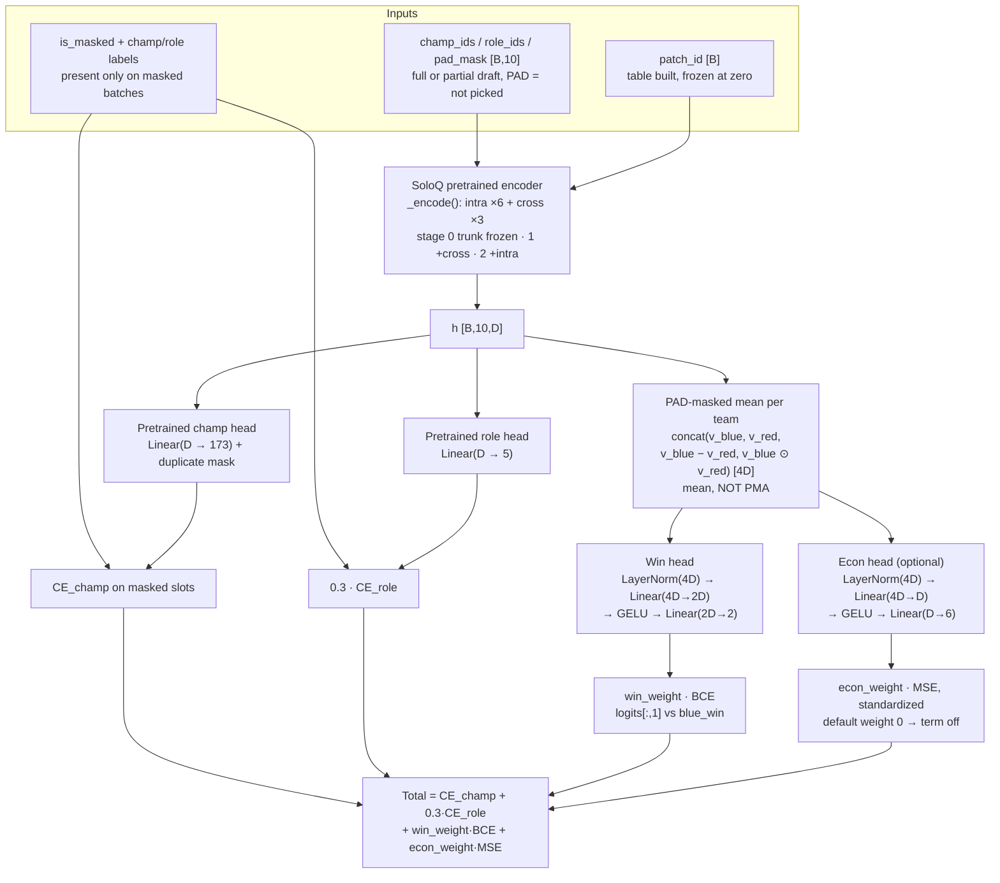
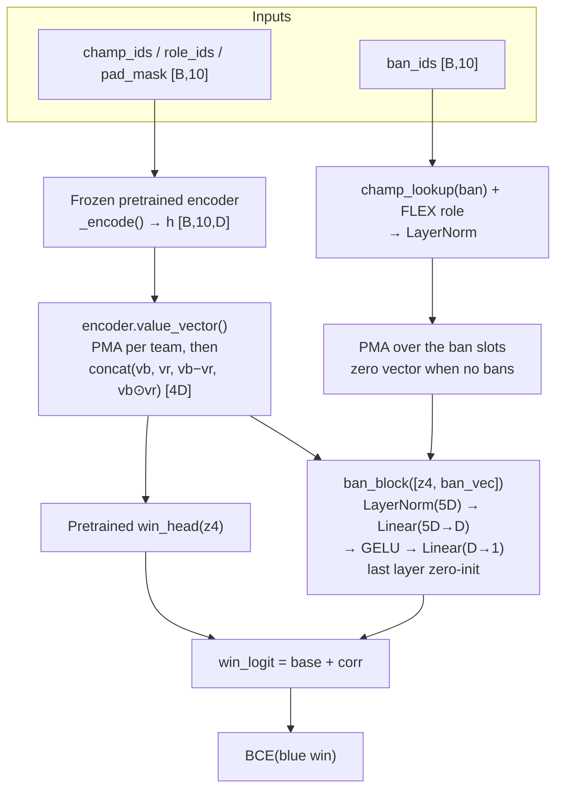

# Pro finetune — Stage 1 (masked heads + win/econ outcome heads)

Loads a SoloQ-pretrained encoder and finetunes it on the 46.6k pro drafts
(`data/pro play/pro_drafts.pt`) while training outcome heads for the value
function used by search (Stage 2: MCTS/lookahead).

Terminology, because "pool" is overloaded: **fearless pool** means the champions
already picked in earlier games of the series; **pooling / pooled** means the set
reduction (here the PAD-masked mean in `ProDraftModel`, PMA in
`PrefixValueModel`), never a champion set. `ProDraftModel` never sees the
fearless pool at all — the encoder reads `champ_ids` / `role_ids` / `pad_mask`
only, and the fearless mask is applied later, as a logit mask in the policy.

> **Value function status.** There are three value paths and they are not
> equivalent. Measured on the same patch-honest test split:
>
> | path | test AUC | verdict |
> |---|---|---|
> | logistic role x champ additive (ban-analysis thread, now removed) | 0.5456 | best; structurally flat in ban1 |
> | `PoolOutcomeHeads.win` (this stage) | 0.5172 | weak, complete drafts only |
> | `PolicyValueModel.value_head` | 0.4969 | broken at every depth - head removed from new runs |
>
> The econ head is **off by default** (`--econ-weight 0`): it scored
> econ_skill -0.09 to -0.15 and nothing downstream reads `econ_pred`.
> `value.py` (below) is the attempt to do better than all three on partial
> states; it currently reaches 0.5124 on all prefixes and 0.5194 at move 19,
> so the additive model still wins. See the `value_report.json` beside the
> weights written by `--out-dir`.

## Architecture — Stage 1 (`ProDraftModel`, from `model.py`)



Defaults and quirks that the diagram would otherwise hide:

- **`--win-weight 1.0`, `--econ-weight 0.0`, `--lambda-role 0.3`.** The econ
  head is *constructed* (6 outputs = `ECON_KEYS`) but its loss term is zero by
  default, so it stays at its random initialisation; `--econ-weight 0` is the
  shipped setting.
- **Only `win_logits[:, 1]` is ever used.** Both the BCE and the `win_auc` /
  `win_brier` evaluation read column 1, against the `blue_win` label; column 0
  receives no gradient and is never scored. The head is 2-wide but effectively
  1-wide, despite the `[blue, red]` comment in `PoolOutcomeHeads`.
- **The patch table is inert in this stage.** `build_encoder` is called with
  `n_patches=107`, but `set_stage` freezes `encoder.embed` at *every* stage, so
  the zero-initialised table never trains. Patch conditioning only becomes an
  active input in the policy model, which owns a trainable patch embedding in
  its own `StateEmbedding`.
- **The encoder's own heads stay trainable** at every stage (they are not in
  the freeze list); embeddings never are. Stage 0 freezes intra + cross,
  stage 1 unfreezes cross, stage 2 adds intra.
- **Pooling is the PAD-masked mean**, not PMA. PMA belongs to the pretraining
  value path and to `PrefixValueModel` below — `ProDraftModel.pool` is the
  mean, so an all-PAD team contributes a zero vector rather than a NaN.

## Prefix value stage (`value.py`)

Separate from the masked-modelling stage: fine-tunes the *pretrained* value
path (`pma` + `win_head`, test AUC 0.5597 in the pretraining probe) on pro
prefix states, trunk frozen, with an optional ban path (PMA over the ban slots)
so V can see bans at all (the encoder cannot - `_encode` reads
champ_ids/role_ids/pad_mask only).



The residual's last layer is zero-initialised, so at step 0 the logit is exactly
the pretrained head; `freeze_trunk()` leaves only `pma`, `win_head`,
`ban_pool` and `ban_block` trainable, and `--unfreeze cross|intra` opens the
trunk on top of that (embeddings never unfreeze). `ban_pool` is a module name,
not a champion set: it is the PMA reduction over the 10 ban slots.

```text
python solo_queue/model/finetune/value.py --init-ckpt auto --epochs 12
python solo_queue/model/finetune/value.py --unfreeze cross --lr-trunk 2e-5
python solo_queue/model/finetune/value.py --score-ckpt ckpt/value_x/best.pt
pytest solo_queue/model/finetune/test_value.py -q                       # 18 tests ~3s
```

That zero start is what makes "what do bans buy us" a clean ablation
(`no_ban_residual` in the report) and keeps the pretrained weights usable.
Reports AUC / Brier / skill-vs-constant by phase, by move index, by patch,
plus complete-draft AUC for comparison against the other two paths.

## Run

```text
python finetune/train.py --run-name stage1-full              # full run
python finetune/train.py --limit-drafts 8000 --epochs0 1 \\
    --epochs1 1 --epochs2 1 --no-wandb --run-name smoke      # smoke
pytest finetune/test_finetune.py -q                           # 7 tests ~3s
```

- **Init**: `--init-ckpt` (default = run1 best.pt, the 4.8M trunk
  recommended by the vague-totem-4 review; `--init-ckpt auto` picks the
  pretraining checkpoint with the highest val champ_top5).
- **Stages**: 0 = outcome heads + encoder readouts only (trunk frozen);
  1 = + cross_team; 2 = + intra_team. Embeddings frozen throughout;
  encoder readouts (champ/role heads) train at the head LR (1e-3) while
  trunk trains at `--lr-enc` (1e-5).
- **Loss** = masked CE (champ + 0.3·role) + win BCE + econ MSE
  (gold/xp @10/@15 per side, standardized on train). `--win-weight`,
  `--econ-weight` scale the outcome terms. Non-finite loss aborts loudly.
- **Data**: recency-weighted sampling over the series-grouped train split;
  `--econ-mask-prob 0.5` mixes full-draft masked examples with random
  1..9-pick subset drafts (the win head must value *partial* states for
  MCTS). `--rehearse-frac` mixes soloQ masked batches during stages 1-2
  (stage 0's trunk is frozen, rehearsal would be a no-op there).
- **Val/test**: masked top-k on full pro drafts (coach metric
  role_cond_top5), win AUC + Brier on full+partial drafts, econ RMSE;
  popularity baselines live in `data/pro play/pipeline.py`. Final
  `test_report.json` evaluates both best checkpoints on the held-out
  test split.

## Checkpoints (`solo_queue/model/checkpoints/masking-finetune/`)

- `best_mask.pt` — best val masked champ_top5 (use for pro finetune
  masked eval / as a better trunk for later stages)
- `best_win.pt` — best val win AUC (use as the MCTS value function)
- `latest.pt` — last epoch of stage 2
- Payload: model + config + metrics + `platt` (calibration a·x+b fitted
  on val) + `econ_mean`/`econ_std` (standardization, so inference can
  destandardize) + init provenance.

`--out-dir` writes a run straight to its final name; without it the run lands
in `ckpt/run_<ts>[_<name>]/`. The `value.py` stage writes to whatever
`--out-dir` says, and its `value_report.json` sits next to the weights.

## Notes / known limitations

- Win head is trained per-side-neutral: label is "blue wins"; red-side
  querying = swap slots (the PMA pool is order-aware per side, so evaluation
  code must mirror the draft when querying for red).
- Random subsets can leave one team with 0 visible picks; the encoder
  treats an all-PAD team as attendable (single forward over the PAD
  embeddings) to avoid MHA NaN — the pooled vector for that team stays zero.
  Regression-tested in `test_finetune.py`.
- Platt/econ stats are fit on VAL, not test (calibration must not leak).
