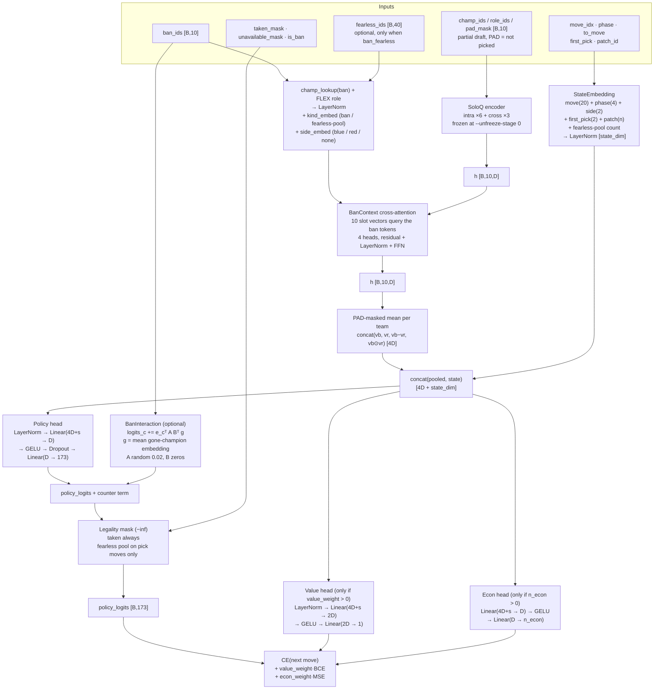

# Policy-value model (Stage 2): next-move prediction + win value

Decoupled policy + value architecture on top of the frozen SoloQ
pretrained encoder. Trains on `ProNextMoveDataset` (20 examples per
game from the 46.6k pro drafts) instead of masked-draft finetuning.

## Why a different architecture?

The finetune approach (`solo_queue/model/finetune/`) trains the encoder on
masked champion completion of full 10-pick pro drafts (the same task
as soloQ pretraining) plus a bolt-on win head. Results were poor:
win AUC ~0.53 (base rate 0.54), and the masked-CE task doesn't teach
next-pick prediction with bans, order, or fearless context.

This stage decouples the two objectives:

- **Policy head**: learns P(next pick/ban | draft prefix, bans,
  fearless, turn, phase, side). Trained directly on the next-move
  task — the thing a coach actually queries.
- **Value head**: learns V(partial draft state) = P(blue wins).
  Trained on the same prefix states, so the value function sees the
  distribution it will encounter at inference (MCTS search).
  **Off by default** (`--value-weight 0.0`): it measured 0.4969 test
  AUC, so the kept checkpoints carry no value path at all, and
  `solo_queue/model/finetune/value.py` is the V that is actually used.

The encoder is **frozen** (its champion/role/synergy knowledge from
soloQ is preserved). Only the ban-context module, state embedding and
policy head train from scratch, plus the value and econ heads when they
are enabled.

## Architecture (`PolicyValueModel`, from `model.py`)

Terminology: **fearless pool** means the champions already picked in earlier
games of the series; **pooling / pooled** means the set reduction (here the
PAD-masked mean), never a champion set.



What the code actually does, where it differs from a generic sketch:

- **The value head is off by default and, when off, does not exist.**
  `--value-weight` defaults to **0.0**, and `train.py` passes
  `with_value=args.value_weight > 0`, so the shipped `nextpick-*` checkpoints
  carry **no `value_head.*` keys at all** — it is not a head with weight 0, it
  is an absent module. When it is built it is a single blue-win logit with
  `BCE`, not a two-way head.
- **The econ head is off by default too.** `--n-econ` defaults to **0**, so the
  head is not constructed; `--econ-weight 0.1` then multiplies a
  graph-connected zero and has no effect. It only matters with
  `--n-econ 6`.
- **`BanContext` uses 4 attention heads regardless of the encoder's 8.** The
  context block is a separate `nn.MultiheadAttention(embed_dim, 4)`, one block
  deep (plus FFN), not a second transformer stack.
- **The policy head does not read a slot.** Its input is the pooled 4D vector
  concatenated with the state embedding; the state is what tells it ban vs
  pick and which side is acting.
- **The counter term reads the raw embedding table**, `champ_lookup.weight`
  sliced to 173 rows, not the LayerNorm'd ban tokens. `A` is `randn * 0.02`
  and `B` is zero, so the term is exactly 0 at step 0 while `d(loss)/dB ≠ 0` —
  zero-initialising both would freeze the product.
- **Legality is asymmetric on purpose.** Training masks `taken_mask` on every
  move and `unavailable_mask` (fearless) on **pick moves only**, because 8 of
  the 100,210 fearless-row ban moves do target a fearless-pool champion.
  Serving folds the fearless pool into `taken_mask`, so the UI never suggests
  one on a pick *or* a ban.
- **The three ban switches are off by default** (`ban_side=False`,
  `ban_fearless=False`, `counter_rank=0`), which is why the shipped
  `nextpick-*` checkpoints are ban-blind. `ban_side` and `counter_rank` are
  zero-initialised; `ban_fearless` is not — the fearless-pool tokens are real
  champion embeddings, so they join the key set at step 0 (see
  `pro/model/bans/README.md`).

Key design choices:

- **Ban context**: banned champions are embedded via the encoder's
  frozen lookup table, then cross-attended into the slot vectors. This
  lets each slot "see" bans when computing its representation — the
  encoder alone can't do this (soloQ pretraining excludes bans).
- **State embedding**: phase (0=bans1, 1=picks1, 2=bans2, 3=picks2),
  side to move (0=blue, 1=red), first-pick side, move index (0..19),
  and **patch id** are all learned embeddings summed together. This
  tells the policy head what kind of move to predict (ban vs pick, which
  side) and which patch's meta applies.
- **Patch conditioning** (`--no-patch` to disable): the patch string was
  previously only present in `meta`, never as a tensor, so the model
  could not represent "which champs are high-priority on this patch".
  That is fatal at move 0, where there are no picks on the board and the
  patch's ban list is the only signal — measured at 12.3% top-5 for the
  model vs 37.4% for a lookup table fit on the test patches. The vocab
  is built over all rows (`build_patch_vocab`), index 0 is UNK for
  patches unseen at training time, and the vocab list is saved in the
  checkpoint config so inference maps patches the same way.
- **Legality masking**: taken (banned|picked) champions always get
  `-inf`; unavailable (fearless-picked) champions get it on **pick moves
  only** in training (see the asymmetry note above). The target champion
  is never in the taken set by construction.
- **Pooling**: same concat(v_blue, v_red, diff, product) as the
  finetune model. PAD-masked means per team. The pooled vector captures comp
  asymmetry; the state embedding adds draft-position context on top.

## Sampling and augmentation

The 20 prefixes of one game are near-duplicates: same draft, same
next-move label, different depth. Unrolling all 20 every epoch inflates
the dataset to 810k examples while the effective sample size stays at
46.6k games — which is why val loss climbed from epoch 1 onward.

- `--prefix-mode random` (default): each game contributes **one**
  example per epoch, at a move index redrawn by `set_epoch()`
  (deterministic in `seed`+`epoch`). An epoch is 80 steps instead of
  1582, so the default is 100 epochs ≈ 8k optimizer steps, roughly the
  budget of a 5-epoch run of the old mode — but each (game, prefix)
  pair is seen once instead of six times.
- `--prefix-mode all`: the old behaviour. Used for val/test always, so
  metrics stay comparable across runs (62,880 test examples).
- `--swap-aug` (default on): mirror blue↔red with p=0.5
  (`datasets.swap_sides`). Valid because the encoder is Siamese with no
  team embedding, so the mirrored draft is the same draft from the other
  side with the win label flipped. Doubles effective data and enforces
  the symmetry the architecture claims. Bans are left untouched on
  purpose: `BanContext` embeds them with no team or position signal, so
  the ban list is already team-agnostic, and a team swap doesn't change
  the chronological ban order.

## Run

```text
python policy/train.py --epochs 100                       # full run (new defaults)
python policy/train.py --epochs 15 --prefix-mode all \
    --no-swap-aug --no-patch                              # old behaviour
python policy/train.py --epochs 100 --no-patch \
    --run-name ablation-nopatch                           # patch ablation
python policy/train.py --limit-drafts 2000 --epochs 2 \
    --no-wandb --run-name smoke                           # smoke
pytest solo_queue/model/policy/test_policy.py solo_queue/model/policy/test_datasets_aug.py -q  # 30 tests ~7s
pytest solo_queue/model/policy/test_infer.py -q                              # 20 tests ~3s (serving)
```

Run the suite as a directory (`pytest solo_queue/model/policy/`), not file by file:
`solo_queue/model/policy/model.py` shadows the `model` package when this directory is
first on `sys.path`, which is what a single-file invocation does.

### Init

`--init-ckpt` (default = `solo_queue/model/checkpoints/masking-soloqueue/best.pt`, the
kept soloQ pretrain; `--init-ckpt auto` resolves to the same file, the one with
the highest val champ_top5 in that family). The encoder is loaded and frozen.

### Stages

- `--unfreeze-stage 0` (default): encoder fully frozen. Only the
  ban-context, state-embedding and policy head train, plus the value and
  econ heads when their flags enable them (neither is on by default).
  This is the recommended starting point.
- `--unfreeze-stage 1`: additionally unfreeze the encoder's
  `cross_team` blocks (at `--lr-enc`). Use if stage 0 plateaus and
  the cross-attention could benefit from pro-specific adaptation.
- `--unfreeze-stage 2`: additionally unfreeze the encoder's
  `intra_team` blocks. Embedding tables stay frozen throughout.

### Loss

```
total = policy_CE(next_move) + value_w * BCE(blue_win) + econ_w * MSE(econ)
```

- Policy CE: cross-entropy over C champions, with -inf masking on
  taken/banned/unavailable champs (the softmax normalizes over legal
  moves only). The target is the actual next move's champion.
- Value BCE: blue-win logit vs binary label. Side-neutral (red
  queries mirror slots). **`--value-weight` defaults to 0.0**, which
  removes the head entirely rather than down-weighting it; the kept
  checkpoints therefore have no value path. This head measured test
  `win_auc` 0.4969 across all 20 prefixes and is worse than a constant
  once the draft fills — use `solo_queue/model/finetune/value.py` for V.
- Econ MSE: standardized gold/xp at 10/15 min per side. **`--n-econ`
  defaults to 0**, so the head is absent; `--econ-weight` defaults to
  0.1 but only has something to weight when `--n-econ 6` is passed.
- Rehearsal (`--rehearse-frac`): soloQ masked batches add
  `CE_champ + 0.3·CE_role` to the same step, which is the only time the
  encoder's own heads receive gradient here.

### Data

`ProNextMoveDataset` (from `data/pro play/datasets.py`): turns each
20-move draft into prefix-to-next-move examples (20 per game in `all`
mode, 1 per game per epoch in `random` mode — see Sampling above). Each
example carries: partial draft (champ_ids/role_ids with PAD for
unpicked), ban list, taken_mask (legality), unavailable_mask
(fearless), turn info (move_idx, phase, side, first_pick), `patch_id`,
win_label, and the econ targets.

Note: `econ_target`/`has_econ` used to be emitted only by
`ProMaskedDraftDataset`, so the policy model's econ head was trained
against nothing at all. `build_prefix` now emits them (90.7% of rows
have econ data), and `evaluate` gates the econ metric on the head
existing, so `--n-econ 0` no longer raises.

Recency-weighted sampling (`--half-life 75d`): recent meta is
upweighted. Series-grouped train/val/test split (no leakage).

### Eval

| Metric | Meaning |
|---|---|
| `top1/5/10` | next-move champion top-k hit rate |
| `ban_top5` | top-5 on ban moves only |
| `pick_top5` | top-5 on pick moves only |
| `win_auc` | blue-win AUC on prefix states |
| `win_brier` | Brier score on win prediction |
| `econ_rmse` | standardized econ RMSE (includes the patch-drift offset) |
| `econ_rmse_centered` | econ RMSE after removing the split's mean residual |
| `econ_rmse_const` | what the best constant predictor scores on this split |
| `econ_skill` | `1 - centered/const` = R²; **> 0 means the head beats a constant** |
| `policy_loss` | mean policy CE |

Reading the econ numbers: gold/XP at 10/15 min inflate patch over patch, so
the val/test targets sit +0.8 to +1.5σ above the train-fitted
standardization. `econ_rmse` alone therefore cannot fall below
`econ_rmse_const` even for a perfect model, because the drift is in the
level and no draft-only model can see it. Judge the head by `econ_skill`.

## Checkpoints (`pro/model/checkpoints/nextpick-*/`)

The two kept artefacts are `solo_queue/model/checkpoints/nextpick-policy/` (soloQ encoder
+ policy head) and `pro/model/checkpoints/nextpick-proonly/` (from scratch). Each
holds:

- `best_policy.pt` — best val next-move top5 (pro-only runs name it `best.pt`)
- `best_value.pt` — best val win AUC, when the run trains a value head
- `latest.pt` — last epoch
- Payload: model + config + metrics + init provenance + econ stats.
  The model state dict includes the encoder under `encoder.` plus all
  new heads/modules — loadable into `PolicyValueModel(encoder, ...)`
  after building the encoder from the init checkpoint.

`--out-dir` writes a run straight to its final name; without it the run lands
in `ckpt/run_<ts>[_<name>]/` and nothing outside the run references it. The
directory name is the contract the frontend reads: `nextpick-*` is offered to
the next-move slot, `masking-*` to the role board, `value-*` to neither.

## Connection to frontend and MCTS

The policy head outputs a distribution over champions for the next
move given the current draft state — exactly what the frontend UI
needs for "suggest next pick/ban." A value head *would* give a win
probability for any partial draft state and enable MCTS search (expand
via policy, evaluate via value), but it is disabled by default: the
shipped checkpoints have no value path, and `solo_queue/model/finetune/value.py`
is the V that actually scored better than the base rate.

To use in the frontend: `infer.py` is that code path. `PolicyPredictor`
builds the board from the UI's picks/bans, resolves the canonical 20-move
order (`move_plan`, mirrored for a red first pick), and runs the policy for
the side on the clock — one forward pass, ban or pick. The patch is an input
(`patch_id`), selected in the UI from the checkpoint's own `patch_vocab`;
`patch_id_for` clamps anything the checkpoint cannot embed to UNK. It
imports no dataset or training module, so serving does not pull in
`datasets.py`. `webapp/server.py` dispatches on the state-dict keys and
exposes it as `POST /api/next-move`; the masked-draft path stays available
for comp-completion queries.

The fearless pool is excluded from every suggestion, pick **or** ban. The
board keeps it separate from `taken` so a board that already bans one still
loads (technically legal, never done), and `_policy_batch` folds it into
`taken_mask` at the inference boundary. Training keeps the looser rule —
`_apply_legality` masks the fearless pool on picks only — because 8 of 100,210
fearless-row ban moves do target a fearless-pool champion, and masking a
training target out of the cross-entropy would dominate the loss.

### Which lane each pick is in (`lanes.py`)

The dataset places a pick at `team * 5 + role`, and the encoder is
permutation-invariant within a team, so a pick's *slot* carries no information —
the role id is the only thing that says where it is. Training read that from the
corpus; serving gets a pick-order board and has to work it out.

`_fill_roles` used to take the role head's argmax. That answers a different
question ("given this champion and team, where could it go") and agrees with the
corpus's real roles 67 % of the time. `lanes.assign_lanes` instead maximises the
champions' own lane history from `data/champ_roles.json`, which agrees 96 % of
the time; on 1,500 held-out pick moves that is **30.2 % -> 37.7 % recall@5**,
against 38.8 % for the true roles. Adding the head's distribution on top of the
prior changes nothing, so the head is kept only for the per-slot distribution
the role board displays — `res["roles"]` — and the table decides the input.

The assignment is injective per team (a team's five lanes are distinct), which
is why it is an exhaustive search over ≤120 assignments rather than an argmax:
two junglers cannot both be the jungler, and the search decides which one moves.

## Ban decisions (moved out)

The ban analyses that used to live here — `ban_search.py` (additive
`W[role, champ]` negamax), `ban_intent.py` (does a ban hit what the opponent
wanted), `ban_propose.py` (propose-and-verify rollouts), their result JSONs and
their tests — were removed on 2026-11-03. They were a finished research thread
whose every result recorded a checkpoint that no longer exists, so nothing in
them could be re-run as written.

Their conclusions are kept in `STATUS.md` §5, which is the record:

- an additive `W[role, champ]` gives every phase-1 ban the same value
  (spread 0.00000 over 19,131 decisions), so phase 1 is structurally
  out of reach for that model class;
- phase-2 bans land in the opponent's predicted top-5 at 29.6% vs 8.3% for a
  frequency baseline (3.6x lift), so the "ban what they are about to take"
  premise is real, but only for a minority of human bans;
- the propose-and-verify rollout is a genuine null: −0.00007 [−0.00055,
  +0.00039] under `V` while changing the simulated draft in 87.9% of decisions.

The rollout in `infer.py` (`ban_candidates`, `_rollout`, `_win_prob`) was
removed on 2026-11-04 as well. A pro-like ban already *is* the denial
decision, so ranking bans by a second, simulated objective only added a
source of error; with no usable value head the simulation had nothing to
score with. The UI's ban suggestions are now the plain next-move
distribution, which is what this model was trained to imitate.

The reason the null is a property of the model class, not the game, is
champion x champion complementarity: an additive `W` scores Karma by its
role alone, so it has no term in which "Karma is worth more next to Ezreal"
could live.
