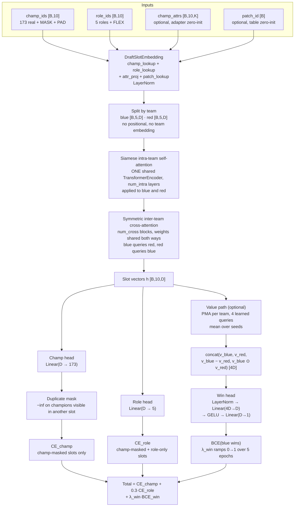

# SoloQ Pretraining

Masked-draft pretraining loop for `base_model.py`. Contract:
`../README.md`; data: `../../data/solo queue/process matchdata/pipeline.py`.

## Architecture (`SiameseBase`, from `base_model.py`)



What the code actually does, where it differs from the root sketch:

- **The value path is opt-in on the class, on in training.** `with_value=False`
  is the constructor default; `train.py` passes `with_value=not --no-win`, so
  the pretraining run trains it and the kept `masking-soloqueue` checkpoint has
  it. `--lambda-win` defaults to **1.0** but is ramped linearly from 0 over
  `--win-warmup-epochs` (default 5), so the win term carries **weight 0 in
  epoch 0** and 1.0 from epoch 5 on. `--win-freeze` can latch it to 0.
- **`attr_proj` and `patch_lookup` are zero-initialised**, so enabling them
  without training is bit-identical to not having them. The shipped soloQ
  config carries neither (`attr_dim`/`n_patches` absent): the kept trunk has no
  attribute adapter and no patch embedding. That matches the data — the soloQ
  corpus here is a single patch, so there is no patch identity to encode.
- **The champ head has 173 outputs, not "173 + mask".** MASK (id 173) and PAD
  (174) are *input* tokens only. The duplicate mask writes `-inf` per slot and
  only at `is_masked` positions — it never changes the head's width.
- **The role head is per-slot** `Linear(D, 5)` on `h`, not on the pooled
  vector; the root diagram's "PMA → role head" is not this model. FLEX is an
  input token only — there is no FLEX output column, and role-only slots
  (`--role-only-prob 0.10`) are what teach P(role | champ).
- **Loss is hard cross-entropy**, not soft CE or cosine similarity.
- The shipped trunk is **D512 / 6 intra / 3 cross / 8 heads** (see its
  `config`); the D256 / 4 / 2 numbers in the section below are the trainer's
  defaults, not the artefact.

## Run

```text
python pretraining/train.py --epochs 30                 # full run (~few min on RTX 4060)
python pretraining/train.py --limit-drafts 4000 --epochs 2 --no-wandb   # smoke
```

First full run scans all shards (~1 min) and caches drafts to
`../../data/solo queue/process matchdata/drafts_16.20.pt`; later runs load
the cache. After collecting new matches: `--rescan`.

## Model size (trainer defaults, 8GB plan)

`embed_dim=256, num_intra=4, num_cross=2, num_heads=8, dropout=0.0`
-> **4.8M params**, `B=1024` + AMP ≈ well under 2GB VRAM on the RTX 4060.
Bigger is still cheap if you want: `--embed-dim 512 --num-intra 6` (which is
what the kept `masking-soloqueue` trunk actually is: D512 / 6 / 3).

## Training

- Hard CE on the masked heads, BCE on the value head:
  `loss = CE_champ(is_masked) + 0.3 * CE_role(role
  labels) + λ_win * BCE(blue_win)` where role labels cover champ-masked AND
  role-only slots (duplicate-logit `-inf` masking lives in the model) and
  λ_win ramps 0 → 1 over the first 5 epochs (`--lambda-win`, `--no-win`).
- AdamW `lr 1e-3`, `wd 0.01`, 3% warmup + cosine to 5%, grad clip 1.0,
  AMP autocast + GradScaler, optional `--grad-accum N`.
- Data: draft-level 95/5 train/val split (`--data-seed`), fresh train
  masks per epoch (deterministic per index+epoch), fixed val masks
  (seed+1). Masking p≈0.15 champ, 90/10 role on those, >=1 champ
  mask/draft, PLUS p≈0.10 role-only (champ visible, role hidden,
  `--role-only-prob`) which teaches P(role | champ).

## Eval (every `--eval-every` epochs, logged as `val/`)

| Metric | Meaning |
|---|---|
| `champ_top1/5/10` | top-k hit on masked champ labels |
| `role_cond_top5` | champ top-5 when role was given (10% masks) - coach-UI metric |
| `role_hidden_top1` | role acc where role input was hidden (set-completion; easy once teammates' roles known) |
| `role_given_champ_top1` | role acc where champ is visible but role hidden - P(role \| champ), the champ->role affinity signal |
| `base_role_top1/5` | popularity baseline: rank of truth in per-role pick order |
| `base_global_top1/5` | popularity baseline: global pick order |

Success gate: beat `base_role_top5` on `champ_top5`, then push
`role_cond_top5`. Random top-1 ≈ 0.6%; trained smoke already passes
`base_global_top1`.

## Checkpoints / W&B

- **One folder per run**: `ckpt/run_<timestamp>[_<run-name>]/best.pt`
  (best val `champ_top5`) + `latest.pt` - re-runs never overwrite each
  other; the folder name also lands in `last_run.json` (`run_dir`) and
  mirrors `--run-name`. Compare runs side by side; W&B runs are separate
  too (same `--run-name` links them). The kept artefact is copied to
  `solo_queue/model/checkpoints/masking-soloqueue/`; `--out-dir` skips the run folder.
- Payload = `{model, config, metrics, step, patch}` - loadable straight
  into `SiameseBase(**config)`.
- W&B: key in the `WANDB_API_KEY` env var, which `docker-compose.yml` loads
  from the git-ignored `.env`; project `lol-draft-pretrain`. Disable with
  `--no-wandb`; failures never kill training. `last_run.json` records the
  final args + score.
